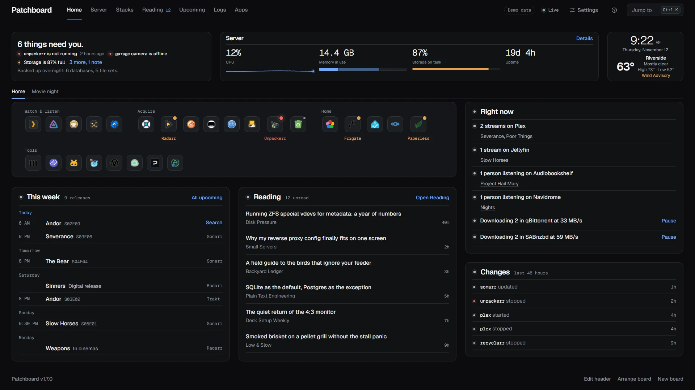
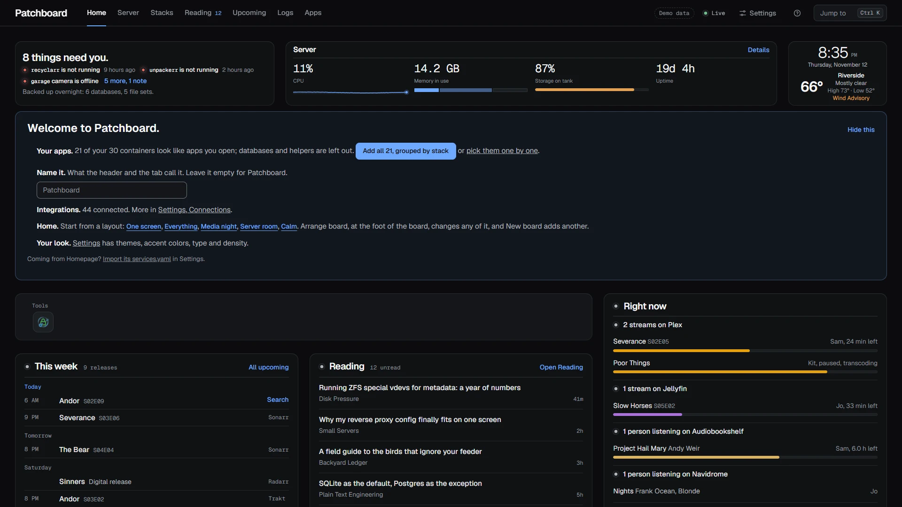
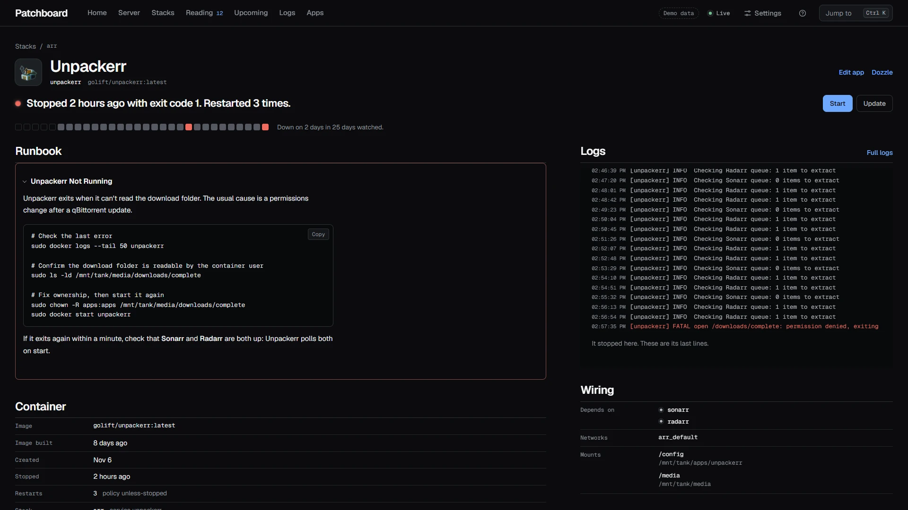
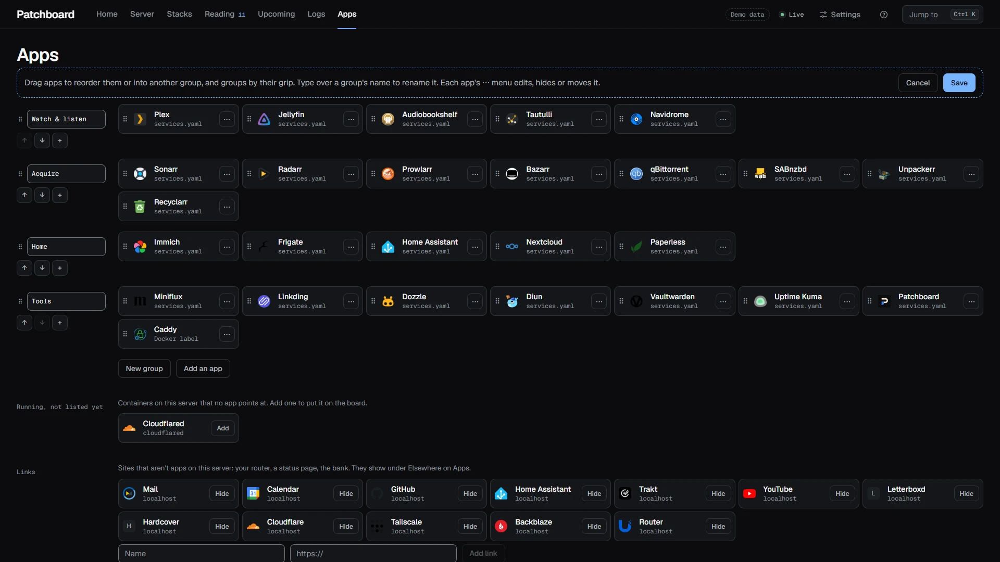
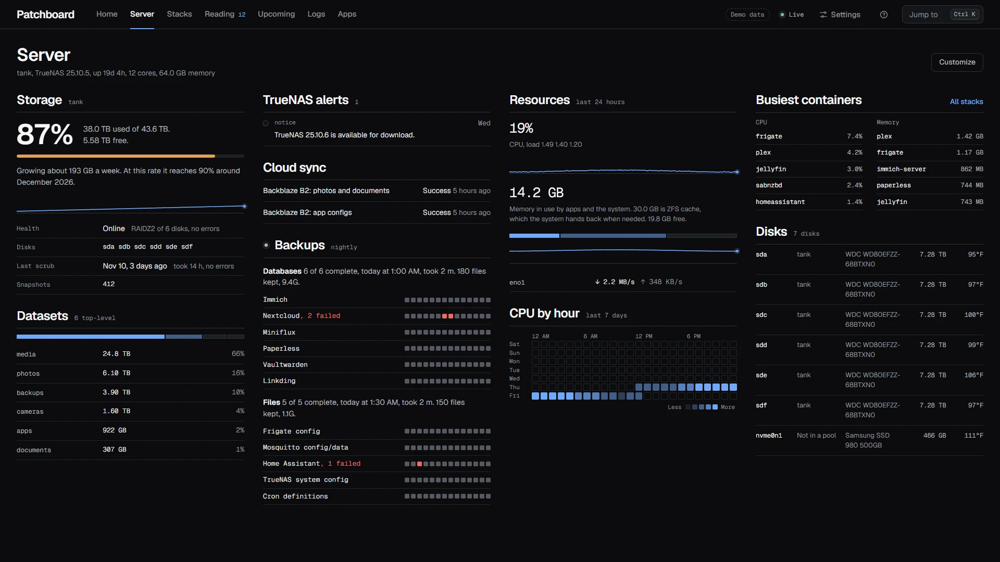
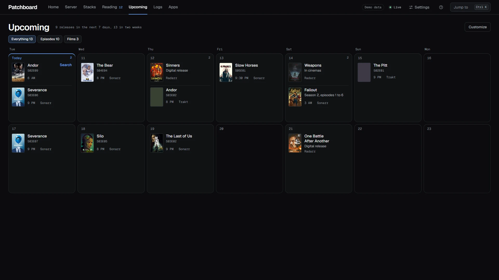
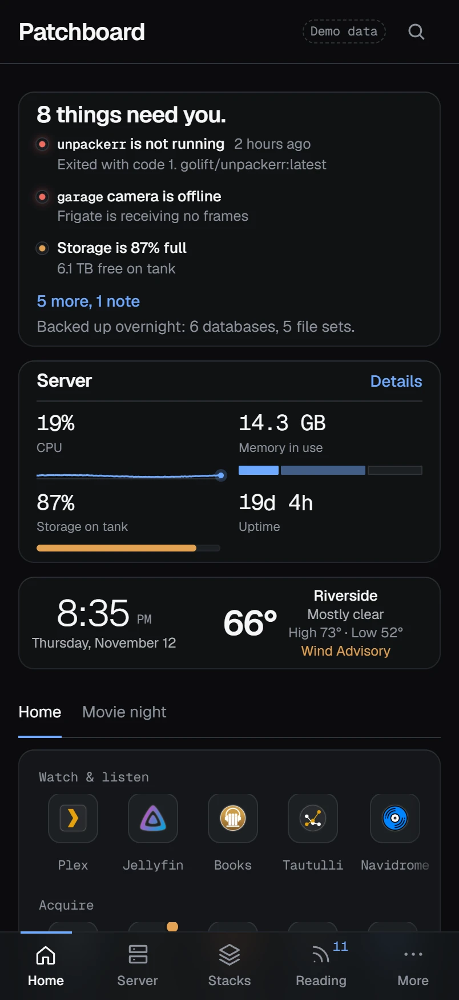
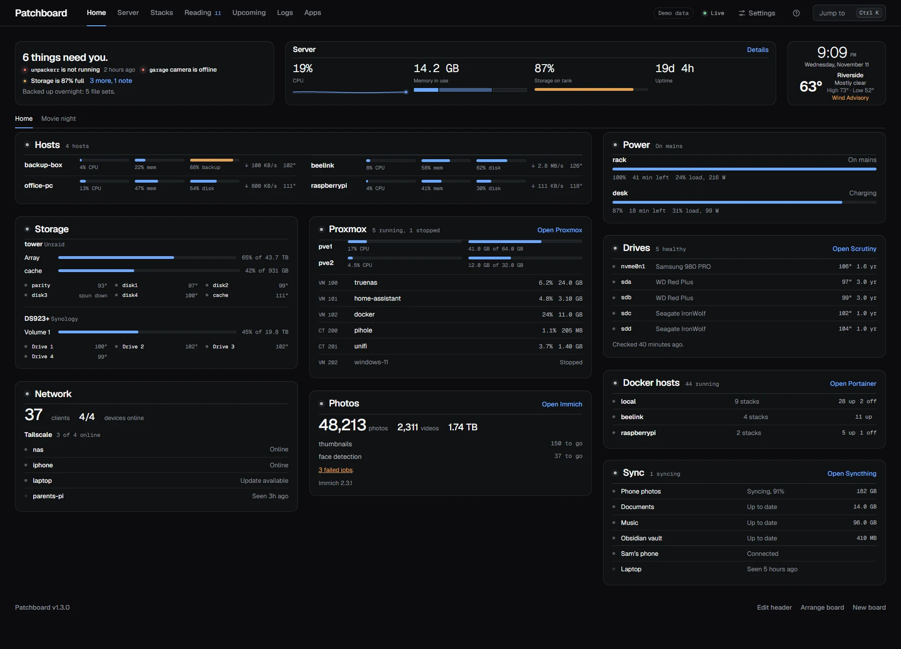
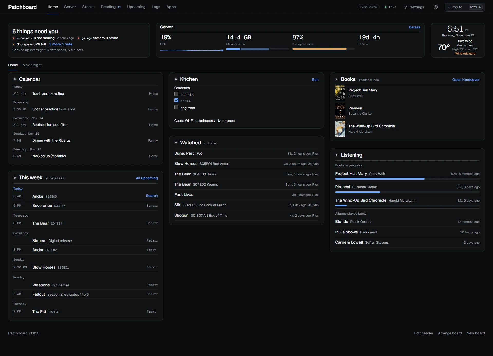

#  Patchboard

[](https://github.com/sourpatchdad/patchboard/actions/workflows/ci.yml)
[](https://github.com/sourpatchdad/patchboard/releases)
[](LICENSE)

A self-hosted start page that tells you what's broken. It reads the Docker
socket, finds your apps, and puts a stopped container, a full pool or a stuck
download at the top, one click from the fix.



## Try the demo

Fake data, nothing saved:

```sh
docker run --rm -p 3200:3200 -e DEMO=1 ghcr.io/sourpatchdad/patchboard:latest
```

Open `http://your-server:3200` (or <http://localhost:3200> on the same
machine). Ctrl-C stops it. Its only outside requests load posters from
TVmaze, pictures from Wikimedia and app icons from jsDelivr.

## Install

```sh
mkdir patchboard && cd patchboard
base=https://raw.githubusercontent.com/sourpatchdad/patchboard/main
curl -fsSL $base/examples/docker-compose.yml -o docker-compose.yml
docker compose up -d
```

Sign-in is off by default, for a home network. Read [SECURITY.md](SECURITY.md)
before you expose it anywhere: turn on a password in Settings, Connections,
Sign-in and keys, or use `AUTH=forward` behind Authelia, Authentik or
Cloudflare Access.

For a read-only install or a small disk, use the `latest-slim` image. It
skips the Docker CLI, so it can't update containers, and it is about 90 MB
smaller. Either image idles at about 50 MB of memory.

Open Patchboard and press **Add all**. It turns every running container into
an app, grouped by compose stack. Coming from Homepage? Settings imports its
`services.yaml`.



Then connect what you run from Settings, Connections: press **Set up**,
paste the address and key, test, save. It connects at once, and the server
stores the key encrypted. There are 68 integrations, among them Sonarr,
Radarr, Plex through Tautulli, Jellyfin, Emby, qBittorrent, Transmission,
Deluge, SABnzbd, NZBGet, Home Assistant, Tessie, Uptime Kuma, Pi-hole,
AdGuard Home, Speedtest Tracker, Overseerr, TrueNAS and weather.
[docs/INTEGRATIONS.md](docs/INTEGRATIONS.md) has the full list.

No `.env` and no config files: the compose file sets the time zone, and the
rest lives in Settings. Prefer config as code? Environment variables and a
`services.yaml` still work, and Settings can copy them in later.
[docs/CONFIGURATION.md](docs/CONFIGURATION.md) has both ways.

`latest` follows releases. Pin `1` to stay on 1.x, or a version like
`1.2.0` to stay put. `edge` is the next release before it ships, and `dev`
is work in progress.
[docs/RELEASING.md](docs/RELEASING.md) lists every tag.

## What you get

**Alerts.** The top of Home says "All quiet" or "6 things need you", with
each problem on its own line, linked to its fix. The browser tab counts
them too. A container that crashed overnight still shows under Changes in
the morning. Turn on ntfy, Gotify, Pushover, Discord, email or a webhook,
and a problem that lasts two minutes reaches you, then again when it clears.

**Container pages.** Each container has a page with its alerts, its runbook
section, live logs, a 30-day health strip, and buttons to restart, update or
roll back.



**Apps without config files.** Drag apps between groups, rename groups,
hide what you don't use, upload icons. Paste an API key and a tile shows
"42,506 photos" or "3 queued". Sixteen apps have presets; any JSON API works.



**Boards.** Home is a board of widgets on 2 to 6 columns. Start from a
layout, drag to move, drag an edge to resize, and turn on Fit the window to
trim lists to one screen. Add more boards: one for the TV, one for the rack.
Five themes come in dark and light, or build a Custom one from three colors.

**Playback.** Hover, focus or tap a playback row for its artwork, details and
a link to its app, with time left when the service reports it.

**Security.** Keys stay on the server. Read-only mode, a Docker socket
proxy, forward auth and an activity log let you decide how much it can do
and see who did what. A household device, set up from a link, gets the
boards, cameras and lights and none of the server controls.

## Pages

| | |
|---|---|
| **Home** | The board: apps, Needs attention, Right now, Downloads, Watched, Listening, Bookmarks, Search, Clocks, Feeds, Releases, Markets, Sun and moon, Countdown, This week, inbox, reading, server, weather, changes, recently added, Next up, hosts, storage, power, drives, Proxmox, Docker hosts, network, photos, cameras, calendar, notes, books, any container or JSON API. |
| **Server** | Pools, datasets, disks, temperatures, scrubs, backups, CPU by hour, and when the pool fills at this rate (TrueNAS, or any mounted folder). |
| **Stacks** | Every container by compose project, sortable by problems, CPU or memory. |
| **Reading** | A Miniflux reader with search, feed and time filters, and keyboard navigation. |
| **Upcoming** | Sonarr, Radarr and Trakt in one calendar, without doubles, with posters. |
| **Weather** | The next 24 hours, the week, sunrise and sunset, US weather alerts. |
| **Logs** | Live container logs, with a hand-off to Dozzle. |

Press `Ctrl K` or `/` to jump to any app, page, container or article.

| Server | Upcoming | Phone |
|---|---|---|
|  |  |  |

| Your machines | Your household |
|---|---|
|  |  |

**[Take the tour](docs/TOUR.md):** every page, every editor, every theme and
the phone views.

## Docs

- [TOUR.md](docs/TOUR.md): every screen.
- [INTEGRATIONS.md](docs/INTEGRATIONS.md): getting apps and numbers onto Patchboard.
- [CONFIGURATION.md](docs/CONFIGURATION.md): every setting, the catalog file, mounts, themes.
- [SECURITY.md](SECURITY.md): what it can do and how to narrow it.
- [examples/](examples/): the plain compose file and a hardened one.
- [RELEASING.md](docs/RELEASING.md): branches, tags, images and how a release ships.
- [ROADMAP.md](docs/ROADMAP.md) and [CHANGELOG.md](CHANGELOG.md)
- [CONTRIBUTING.md](.github/CONTRIBUTING.md): running it locally, and what a new integration or widget needs.

## Development

```sh
npm run dev:demo      # invented data, hot reload
npm test              # node:test
npm run typecheck
npm run docs          # regenerate the tables in docs/INTEGRATIONS.md
npm run screenshots   # regenerate docs/screenshots from demo mode
```

The server is TypeScript that Node 24 or newer runs directly (the image
ships Node 26), with Hono and SQLite. The client is React 19, built with
Vite. [DESIGN.md](docs/DESIGN.md) records why.

Demo and screenshot posters come from [TVmaze](https://www.tvmaze.com) and
Wikipedia and belong to their studios. Demo article photos come from
Wikimedia Commons under the licenses credited in `server/demo.ts`.

## License

AGPL-3.0, copyright 2026 Nathan Nicholas. Run it, change it and share it.
If you hand out a changed version, or run one for other people over
a network, share its source under the same license. See [LICENSE](LICENSE).
