#  Patchboard

[](https://github.com/sourpatchdad/patchboard/actions/workflows/ci.yml)
[](https://github.com/sourpatchdad/patchboard/releases)
[](LICENSE)

A self-hosted homelab dashboard and start page that tells you what's broken.
It reads the Docker socket, finds your apps, and puts a stopped container, a full pool or a stuck
download at the top, one click from the fix.

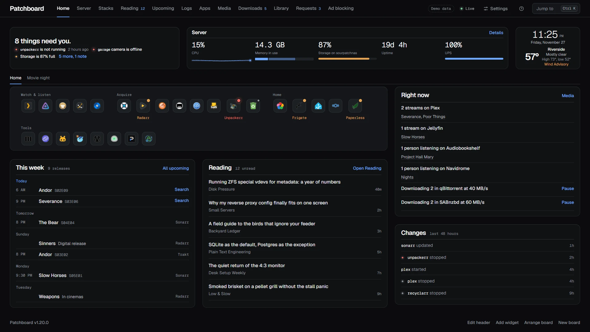

## Try the demo

Fake data, nothing saved:

```sh
docker run --rm -p 3200:3200 -e DEMO=1 ghcr.io/sourpatchdad/patchboard:latest
```

Open `http://your-server:3200` (or <http://localhost:3200> on the same
machine). Ctrl-C stops it. Its only outside requests load posters from
TVmaze, pictures from Wikimedia and app icons from jsDelivr.

## Install

```sh
mkdir patchboard && cd patchboard
base=https://raw.githubusercontent.com/sourpatchdad/patchboard/main
curl -fsSL $base/examples/docker-compose.yml -o docker-compose.yml
docker compose up -d
```

On TrueNAS SCALE, open Apps, Discover Apps, the three dots, Install via
YAML, and paste [examples/truenas.yml](examples/truenas.yml) with your pool's
name in place of `tank`.

On Unraid, fetch the template in a terminal, then open Docker, Add
Container, pick Patchboard and press Apply:

```sh
base=https://raw.githubusercontent.com/sourpatchdad/patchboard/main
curl -fsSL $base/examples/unraid/patchboard.xml \
  -o /boot/config/plugins/dockerMan/templates-user/my-Patchboard.xml
```

Sign-in is off by default, for a home network. Read [SECURITY.md](SECURITY.md)
before you expose it anywhere: turn on a password in Settings, Connections,
Sign-in and keys, or use `AUTH=forward` behind Authelia, Authentik or
Cloudflare Access.

For a read-only install or a small disk, use the `latest-slim` image. It
skips the Docker CLI, so it can't update containers, and it is about 90 MB
smaller. Either image idles at about 50 MB of memory.

Open Patchboard and one sheet asks for a name, an icon and your town, with
the apps it found already ticked. Press **Open Patchboard** and your board is
there. Coming from Homepage? Settings imports its `services.yaml`.

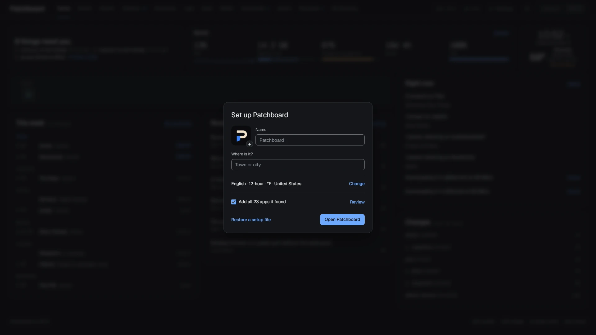

Then connect what you run from Apps: open an app, or **Add an app** and
pick it, then paste the address and key, test, save. Settings, Connections
lists every service in one place, opens on the apps it found running and
hasn't connected, and fills in their addresses, so most take one pasted
key. A widget that needs an app has Connect on its card. It connects at once, and the server
stores the key encrypted. There are 71 integrations, among them Sonarr,
Radarr, Plex through Tautulli, Jellyfin, Emby, qBittorrent, Transmission,
Deluge, SABnzbd, NZBGet, Home Assistant, Tessie, Uptime Kuma, Pi-hole,
AdGuard Home, Speedtest Tracker, Overseerr, Paperless, Nextcloud, BitAxe,
TrueNAS and weather.
[docs/INTEGRATIONS.md](docs/INTEGRATIONS.md) has the full list.

No `.env` and no config files: the compose file sets the time zone, and the
rest lives in Settings. Prefer config as code? Environment variables and a
`services.yaml` still work, and Settings can copy them in later.
[docs/CONFIGURATION.md](docs/CONFIGURATION.md) has both ways.

Scripts, Home Assistant and AI assistants can read it too, through a
read-only API with its own keys and an MCP endpoint.
[docs/API.md](docs/API.md) shows how.

`latest` follows releases, which come every week or so. Pin `1` to stay on
1.x, or a version like `1.2.0` to stay put. `edge` is the beta: every
change, a week before it's released. `dev` is work in progress.
[docs/RELEASING.md](docs/RELEASING.md) lists every tag.

## What you get

**Alerts.** The top of Home says "All quiet" or "6 things need you", with
each problem on its own line, linked to its fix. The browser tab shows the
count too. A container that crashed overnight still shows under Changes in
the morning. Turn on ntfy, Gotify, Pushover, Discord, email or a webhook,
and a problem that lasts two minutes reaches you, then again when it clears.

**Container pages.** Each container has a page with its alerts, its runbook
section, live logs, a 30-day health strip, and buttons to restart, update or
roll back.

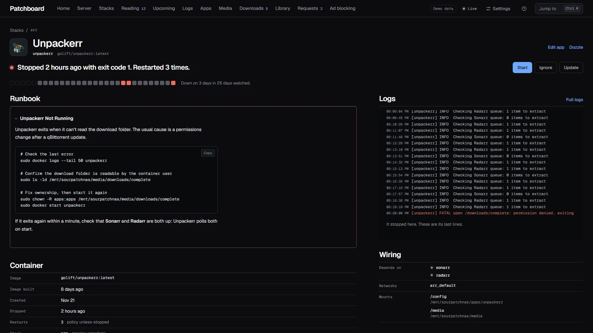

**Apps without config files.** Drag apps between groups, rename groups,
hide what you don't use, upload icons. Paste an API key and a tile shows
"42,506 photos" or "3 queued". Sixteen apps have presets; any JSON API works.

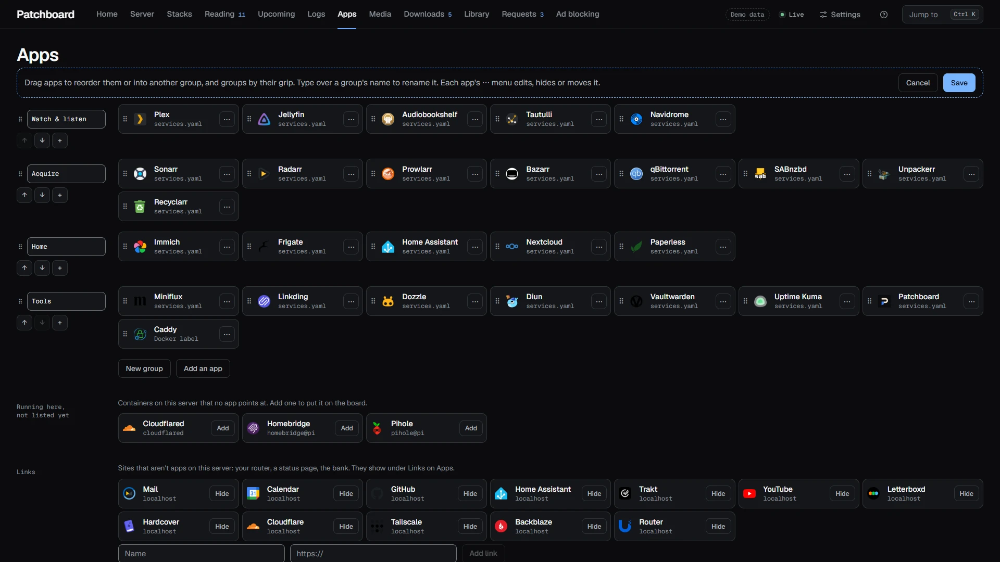

**Boards.** Home is a board of widgets on 2 to 6 columns. Add widget shows
every widget as a live preview at the size it will be, with sample data for
apps you haven't connected yet. Start from a layout, drag to move, drag an
edge to resize, and turn on Fit the window to trim lists to one screen. Add more boards: one for the TV, one for the rack.
Six themes come in dark and light, Blueprint among them, or build a Custom one from three colors.

**Wall screens.** Hang a tablet, an e-ink reader or an e-paper panel and
set it up from your desk in Settings, Devices: its pages, theme, density,
units and language change there, and the device follows within a second.
A household device gets its own pages to swipe between (the Monitor, wall
boards for the clock and weather, markets, the house, cameras, media or the car),
turns them by itself if you like, and dims at night. Set its screen to
E-ink for black on white with a redraw a minute.

Status widgets can show as one big number with a faint line of their day.
A device can show one widget alone, for a Pi with a small screen, and a
TRMNL, Inky or ESP32 with no browser fetches a one-bit picture of the
server, or of one widget's number.

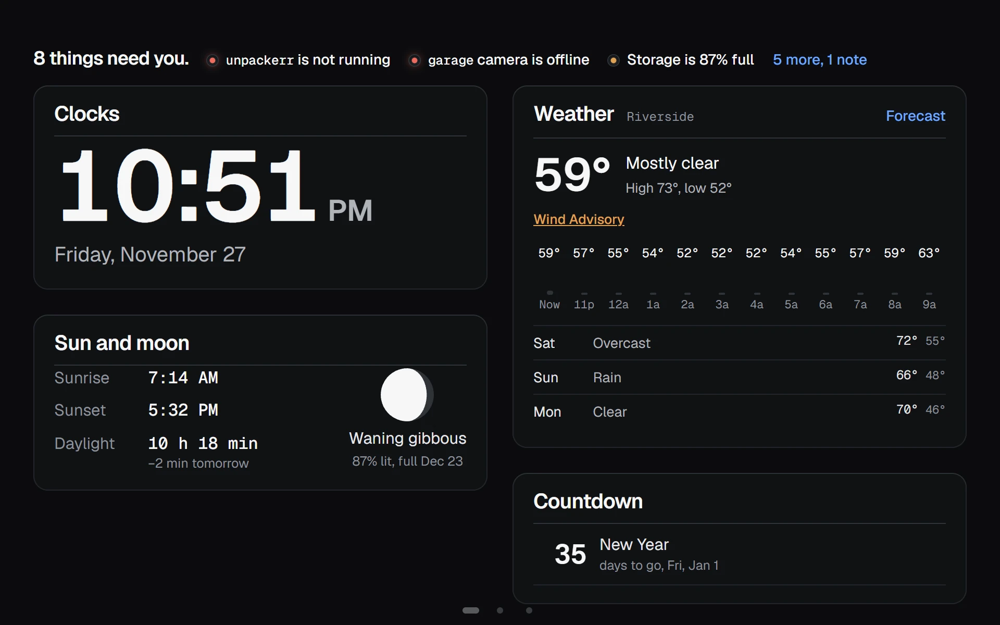

**The house.** From Home Assistant: a shopping or to-do list to tick off
and add to, the thermostat with minus and plus, blinds and shades, who's
home, and each room's last day of temperature as a strip. Chores counts the
days since the plants were watered or the filter changed. The car shows its
charge over the week, the cabin and outside temperatures, and the four tires
with a soft one named; its Dashboard style is a live drawing sheet you can
swipe to turn the car and tap part by part, holding to lock it, open the
frunk or start charging. Miners covers BitAxe and other AxeOS miners. A
kitchen tablet can tick the list and mark chores done; Home Assistant's
locks and garage doors stay read-only for everyone, and the car's controls
never reach a household device.

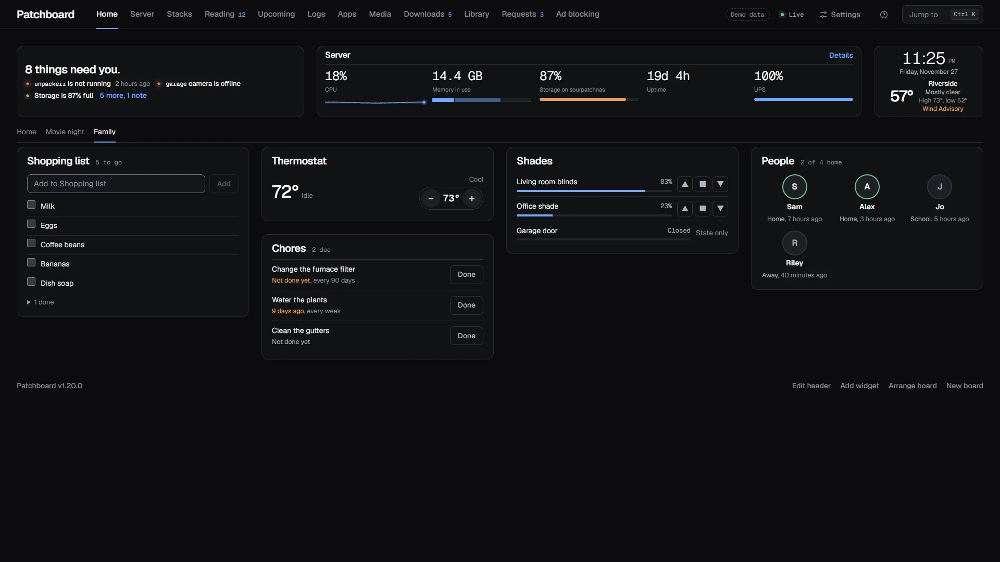

**Your language and region.** Dates, times, numbers and prices follow your
part of the world, from 28 regions. Patchboard comes in German, Spanish,
French, Italian, Dutch and Brazilian Portuguese as well as English, Settings
and problem titles included. Adding a language takes one file.

**Playback.** Hover, focus or tap a playback row for its artwork, details and
a link to its app, with time left when the service reports it.

**Security.** Keys stay on the server. Read-only mode, a Docker socket
proxy, forward auth and an activity log let you decide how much it can do
and see who did what. A household device, set up from a link, gets the
boards, cameras and lights and none of the server controls.

## Pages

| | |
|---|---|
| **Home** | The board: apps, Needs attention, Right now, Downloads, Watched, Listening, Links, Search, Clocks, RSS feeds, Releases, Markets, Sun and moon, Countdown, This week, inbox, reading, server, weather, changes, recently added, Next up, hosts, storage, power, drives, Proxmox, Docker hosts, network, photos, cameras, calendar, notes, chores, books, the car, Home Assistant lists, thermostat, shades, people and rooms, media managers, documents, Nextcloud, Git, monitoring alerts, miners, any container or JSON API. |
| **Server** | Pools, datasets, disks, temperatures, scrubs, backups, CPU by hour, and when the pool fills at this rate (TrueNAS, or any mounted folder). |
| **Stacks** | Every container by compose project, sortable by problems, CPU or memory. |
| **Reading** | A Miniflux reader with search, feed and time filters, and keyboard navigation. |
| **Upcoming** | Sonarr, Radarr and Trakt in one calendar, without doubles, with posters. |
| **Media** | Plex, Jellyfin and Emby: who's watching, stop a stream, scan a library. |
| **Downloads** | Every torrent and NZB in every client: pause, resume, remove, add. A torrent's files, priorities, speed limits and category. |
| **Library** | Sonarr's shows and Radarr's films: monitor, search, what's missing, the queue, history, add new ones. Each show's seasons and episodes. Bazarr's missing subtitles and Prowlarr's indexers too. |
| **Ad blocking** | Pi-hole or AdGuard Home: the query log, allow or block a domain, your lists, pause. |
| **Requests** | Overseerr or Jellyseerr: approve, decline, see what's on the way, request something new. |
| **Weather** | The next 24 hours, the week, sunrise and sunset, US weather alerts. |
| **Logs** | Live container logs, with a hand-off to Dozzle. |

Press `Ctrl K` or `/` to jump to any app, page, container or article.

| Server | Upcoming | Phone |
|---|---|---|
| 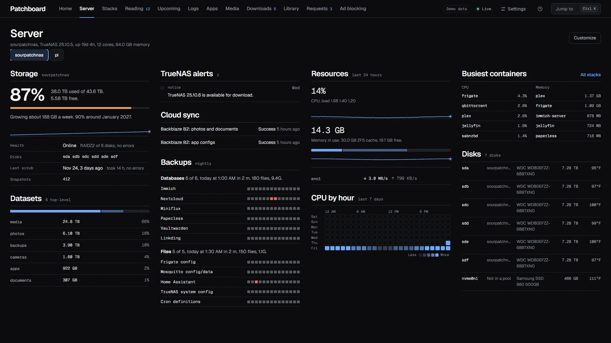 | 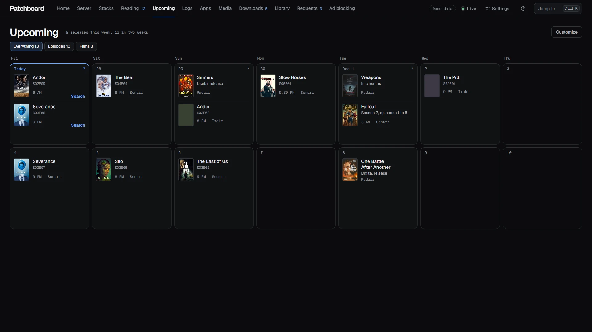 | 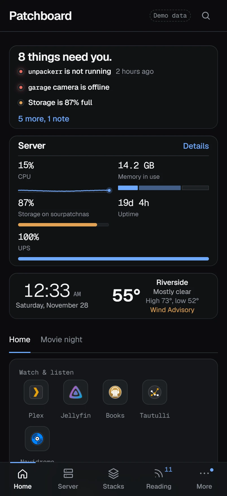 |

| Your machines | Your household |
|---|---|
| 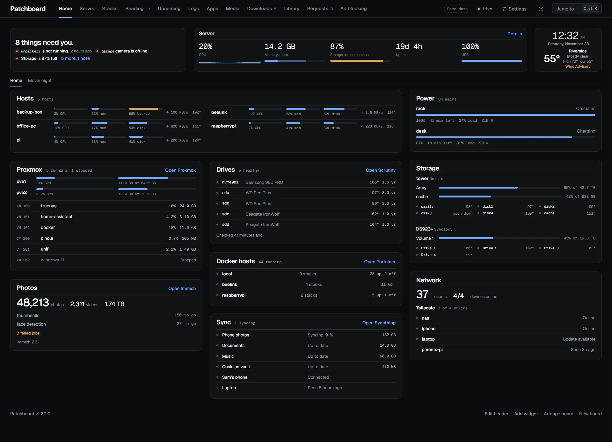 | 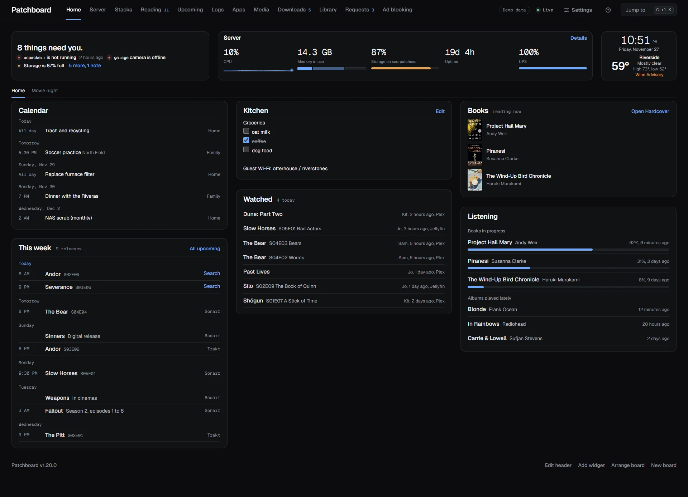 |

**[Take the tour](docs/TOUR.md):** the pages, editors, themes and phone
views.

## Docs

- [TOUR.md](docs/TOUR.md): each screen, with screenshots.
- [INTEGRATIONS.md](docs/INTEGRATIONS.md): getting apps and numbers onto Patchboard.
- [CONFIGURATION.md](docs/CONFIGURATION.md): settings, the catalog file, mounts, themes.
- [SECURITY.md](SECURITY.md): what it can do and how to narrow it.
- [examples/](examples/): the plain compose file and a hardened one.
- [RELEASING.md](docs/RELEASING.md): branches, tags, images and how a release ships.
- [ROADMAP.md](docs/ROADMAP.md) and [CHANGELOG.md](CHANGELOG.md)
- [CONTRIBUTING.md](.github/CONTRIBUTING.md): running it locally, and what a new integration or widget needs.

## Development

```sh
npm run dev:demo      # invented data, hot reload
npm test              # node:test
npm run typecheck
npm run docs          # regenerate the tables in docs/INTEGRATIONS.md
npm run screenshots   # regenerate docs/screenshots from demo mode
```

The server is TypeScript that Node 24 or newer runs directly (the image
ships Node 26), with Hono and SQLite. The client is React 19, built with
Vite. [DESIGN.md](docs/DESIGN.md) records why.

Demo and screenshot posters come from [TVmaze](https://www.tvmaze.com) and
Wikipedia and belong to their studios. Demo article photos come from
Wikimedia Commons under the licenses credited in `server/demo.ts`.

## Star history

<a href="https://www.star-history.com/?repos=sourpatchdad%2Fpatchboard&type=date&logscale=&legend=bottom-right">
 <picture>
   <source media="(prefers-color-scheme: dark)" srcset="https://api.star-history.com/chart?repos=sourpatchdad/patchboard&type=timeline&theme=dark&logscale&legend=bottom-right" />
   <source media="(prefers-color-scheme: light)" srcset="https://api.star-history.com/chart?repos=sourpatchdad/patchboard&type=timeline&logscale&legend=bottom-right" />
   
 </picture>
</a>

## License

AGPL-3.0, copyright 2026 Nathan Nicholas. You may run, change and share it.
If you hand out a changed version, or run one for other people over a
network, share its source under the same license. See [LICENSE](LICENSE).
