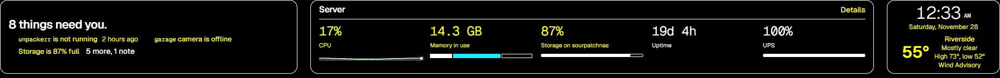

# Accessibility checks

Patchboard's automated checks exercise the browser accessibility tree and
rendered layout. They don't prove WCAG conformance or replace testing with a
screen reader.

Run `npm run test:a11y` and `npm run test:zoom` with Chrome or Chromium
installed. Set `CHROMIUM_PATH` if needed. `npm run test:textzoom` needs
Playwright's Firefox: `npx playwright-core install firefox`. CI runs the same checks after
building, against a temporary demo database; it never uses your saved boards or integration settings.

## Built in

- **Hold to confirm** (Stop, Restart, Update, Remove) also works without
  holding: a screen reader, voice control or switch press arms the button,
  and a second press within five seconds confirms.
- **Single-key shortcuts** (/, ?, g then a letter, j and k) can be turned
  off in Settings, Look, Keyboard, for speech input. Ctrl K always works.
- **Arrange board** works without dragging: Move earlier, Move later, a
  Column menu and width buttons. A move keeps focus on the widget and says
  where it went.
- **Overlays** hold focus, close with Escape and return focus to what
  opened them. Focus moves into an opened article.

## Automated coverage

- Home, Server, Stacks, Reading, Upcoming, Apps, and Home/Connections settings:
  accessible names for exposed controls, meters, dialogs and navigation; one
  main landmark and named navigation.
- Reflow at 960 and 320 CSS pixels, the content widths of a 1920px window at
  200% zoom and a 1280px window at 400%. No page may scroll sideways, except
  the poster rows built to scroll.
- Home in light and dark forced-color palettes: visible usage bars, distinct
  memory segments, header card outlines, and a named keyboard-help dialog
  that fits a narrow viewport.
- Usage meters expose their subject and percentage; charts expose their
  purpose, including the unavailable-history state.
- Afterward, the check confirms the saved setup is unchanged.

## Contrast in every look

`npm run test:contrast` opens 17 pages in all twelve theme looks (six themes,
dark and light), e-ink and color e-ink. It measures each visible text
against the color painted behind it and fails under 4.5:1, or 3:1 for large
text. Text over a picture, disabled controls and faded (stopped) apps are
left out. Plain e-ink also fails on any colored text, fill or border.
`themes.test.ts` checks the tokens themselves: text, the accent, every
accent preset and the status colors on each neutral surface.

A separate script, `npm run test:ui`, checks Home placement, full poster
rows, Fit, keyboard containment, Escape, focus return, canceled editor
drafts, import cancellation and the skip link. Unit tests cover theme text
contrast.

Home header with Chromium's dark forced-color palette:

## Fit, taps and hovers

`npm run test:fit` visits every page at desktop, laptop, tablet and iPhone
sizes, in the default look and a wide one (mono font, large density), and
opens everything a button opens on each. It fails when:

- the page scrolls sideways;
- a box scrolls further than what's in it, as when an invisible tap area or
  hint stretches it;
- text is cut off without an ellipsis;
- anything opened leaves the screen;
- on touch, a control answers less than 44 pixels around its middle, or
  another control's tap area covers it;
- on desktop, hovering a hold button or a chart makes anything scroll.

`--full` adds a 360-pixel phone, an iPad on its side, a 960 by 600 wall
tablet, a 1080p kiosk, Compact density and the light Paper theme; `--only=/media` checks one
page. To check your own install, with your look and your data, set
`FIT_BASE` to its address and `FIT_PASSWORD` to its password. There the
check only reads: the browser blocks every request that would change
something.

## Actual browser zoom and enlarged text

`npm run test:zoom` uses a temporary Chromium profile and the browser's own
zoom preference. It verifies the device pixel ratio changes at 100%, 200%
and 400%, then visits the same eight views and opens the Server editor.
The document must avoid horizontal scrolling, the editor must fit, and its
Save action must scroll into view. Canceling must leave the saved setup as
it was.

It then sets Chromium's minimum font to 24px and checks those views again.
Home weather lines, Reading metadata and calendar times must not overlap.
The script deletes the temporary profile and leaves the shared browser
alone.

## Firefox text-only zoom

`npm run test:textzoom` turns on Firefox's Zoom Text Only and sets it to
200%, the size WCAG asks for. Page zoom narrows the layout until a phone's
takes over; text zoom keeps the desktop layout and doubles the words in it,
so the desktop layout itself has to make room. At 1280 pixels wide, across
16 views, the check fails when:

- the page scrolls sideways;
- the top bar runs past the window, or two things in it overlap;
- a widget's count or link runs out of its heading.

The top bar measures itself: when its contents outgrow it, it steps down
to the compact forms a narrower window gets, whatever the window's width.

Past 200%, at 300%, the bar holds but board columns don't: their widths
stay put while the words triple, and long words break across lines.

## Manual release checks still required

Use a real install with representative integration data, and record the
browser, OS, assistive technology and result:

1. Use NVDA with Firefox or Chrome, or VoiceOver with Safari. Navigate by
   landmarks and headings, then follow Home links, read server measurements,
   open playback previews, and edit and cancel a board. Check announced names,
   values, expanded states, dialog boundaries and focus return.
2. Repeat 200% and 400% zoom in supported browsers. Check every view and
   editor for clipped controls, unreadable truncation, lost content and
   horizontal document scrolling. Poster rows should keep their items and
   stay reachable by keyboard.
3. On Windows, turn on a real contrast theme. Check keyboard focus, selected
   tabs, disabled actions, warnings, graphs and dialogs. Chromium's emulation
   covers system-color rendering but not every OS/browser combination.

Before the spoken walkthrough, the accessibility tree of every page was
read through as a screen reader would announce it (2026-11-23): headings,
group names, link names, form labels and times. Times read in full ("40
minutes ago"), app groups and Ad blocking's Pause buttons are announced
as groups, and every search field has a name.

Chromium zoom, minimum-font and Firefox text-only zoom checks run in CI.
A spoken screen-reader walkthrough and native Windows contrast-theme checks
still need their own platforms. Keep the
accessibility roadmap item open until these manual checks are recorded.
