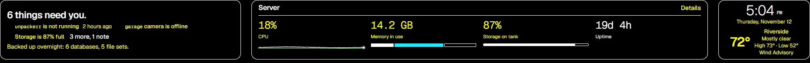

# Accessibility checks

Patchboard's automated checks exercise the browser accessibility tree and
rendered layout. They do not establish WCAG conformance or replace testing
with a screen reader.

Run `npm run test:a11y` with Chrome or Chromium installed. Set `CHROMIUM_PATH`
if needed. CI runs the same checks after building, against a temporary demo
database; it never uses your saved boards or integration settings.

## Automated coverage

- Home, Server, Stacks, Reading, Upcoming, Apps, and Home/Connections settings:
  accessible names for exposed controls, meters, dialogs and navigation; one
  main landmark and named navigation.
- Reflow at 960 and 320 CSS pixels, corresponding to the content widths of a
  1920px window at 200% zoom and a 1280px window at 400%. Each page must avoid
  horizontal document scrolling. Deliberate horizontal poster rows can scroll.
- Home in light and dark forced-color palettes: visible usage bars, distinct
  memory segments, header card outlines, and a named keyboard-help dialog
  that fits a narrow viewport.
- Usage meters expose their subject and percentage; charts expose their
  purpose, including the unavailable-history state.
- The check verifies that the saved setup is unchanged afterward.

`npm run test:ui` separately checks Home placement, full poster rows, Fit,
keyboard containment, Escape, focus return, cancelled editor drafts, import
cancellation and the skip link. Theme text contrast has unit-test coverage.

Home header with Chromium’s dark forced-color palette:

## Manual release checks still required

Use a real install with representative integration data and record the browser,
OS, assistive technology and result:

1. Use NVDA with Firefox or Chrome, or VoiceOver with Safari. Navigate by
   landmarks and headings, then follow Home links, read server measurements,
   open playback previews, and edit and cancel a board. Check announced names,
   values, expanded states, dialog boundaries and focus return.
2. Set browser zoom to 200% and 400%, then increase text size independently.
   Check every view and editor for clipped controls, unreadable truncation,
   lost content and horizontal document scrolling. Poster rows should retain
   their items and remain reachable by keyboard.
3. On Windows, enable an actual contrast theme. Check keyboard focus, selected
   tabs, disabled actions, warnings, graphs and dialogs. Chromium's emulation
   covers system-color rendering but not every OS/browser combination.

A spoken screen-reader walkthrough and actual browser/text-only zoom have not
been completed in the automated cloud environment. Keep the accessibility
roadmap item open until these manual checks are recorded.
