# Tour

Every screen, from demo mode. `npm run screenshots` makes these images, so
they match the current code.

## Home

The default header puts status beside full server graphs, then the time and
date above the weather in a centered card. On a desktop, the quiet status
stays on one line. Edit header, at the foot of Home, opens its controls
over the board, below the header so each change shows at once: four
checkboxes, with sizing and forecasts in Sizes and forecast
details. Header preferences apply to this device. Arrange board controls the
shared widget layout and leaves saved boards as they are.

The version sits at the foot of Home, on the left. It reads "Update to
v1.2.0" when a newer release is out, and "What's new in v1.2.0" once after you update.
Either opens what each release changed, with Update right there when
Patchboard can update itself. If your compose file pins an exact version, it
tells you which tag to switch to instead.

Below the header sits a board of widgets on the columns you choose. Right
now shows who is watching Plex, Jellyfin or Emby and what each download
client is doing, with a Pause button per client. Recently added merges every server newest first. A file Plex and
Jellyfin both added shows once, labeled Plex + Jellyfin, even when the two
name it a little differently.

Point at any line on a chart, or tap it on a phone, to read the value at
that moment and when, in a small tag above the line.

Hover, focus or tap a playback row in Right now to see its artwork and
playback details. The preview shows artwork, never a live video frame. Time
played and remaining appear when the service reports them; Navidrome shows
no progress it doesn't have. Open the app from the preview. Close it with
Escape, Close or a tap outside.

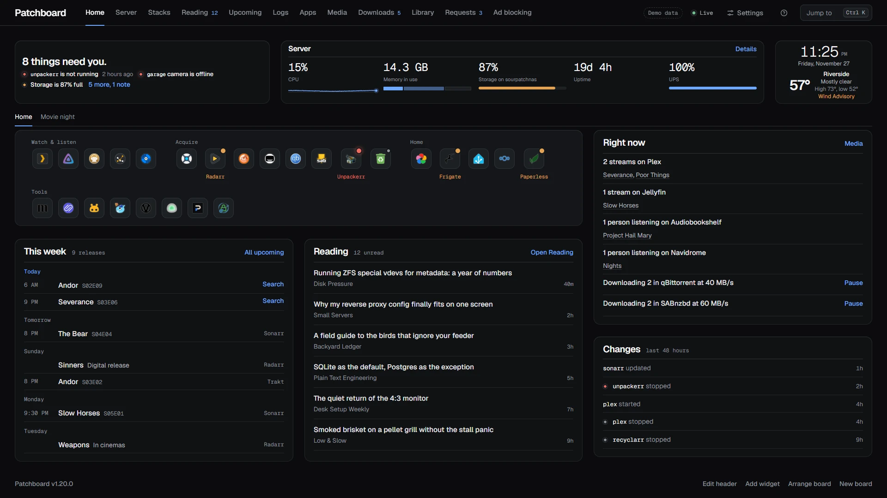

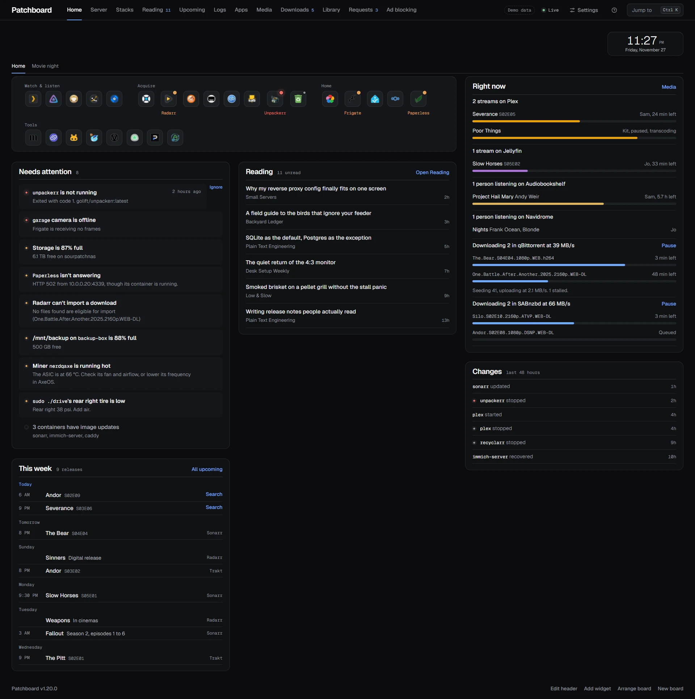

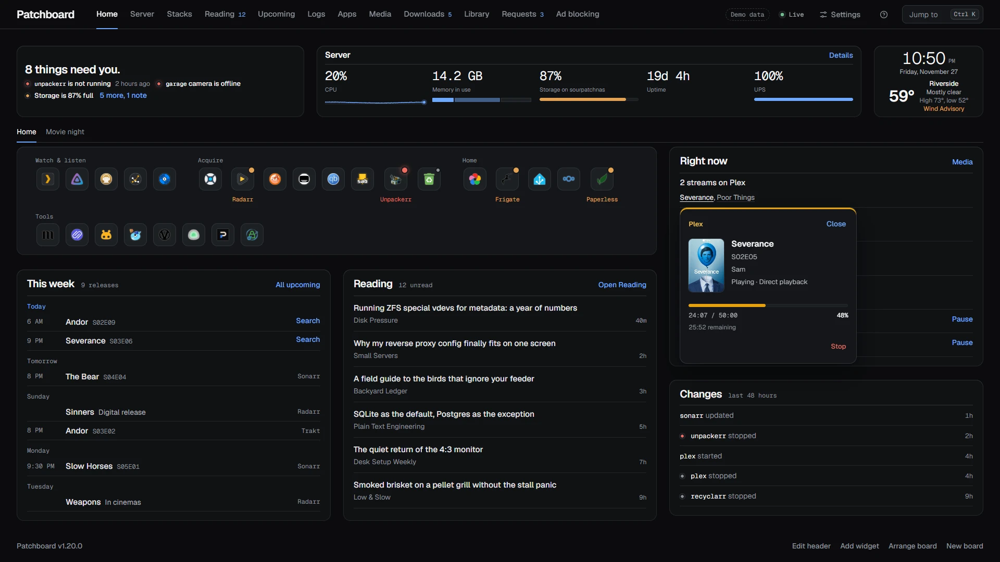

**Status:** the header names problems, the tab title counts what needs you,
as in "(2) Patchboard", and the tab icon carries a dot.

**Needs attention** sits in Home's header, with problem links wrapping under
the status line, worst first. Three show, and the rest wait in a panel a
click away, so the board never moves. To keep it as a card on the board
instead, open Arrange board, then More, then Edit Needs attention,
and pick A card on the board. Hiding header status also shows this widget
as a card on this device, without changing its saved setting. Home always
keeps it; another board, say one just for media, can remove it, and its
status line then leads back to Home's list.

A container you stopped on purpose gets **Ignore** beside it, and its page
has the same button. It stays out of Needs attention until it runs again,
so a later crash still shows.

## Pages

**Server:** pools, datasets, backups, disks, CPU by hour, and when the pool
fills at this rate. On a short landscape screen, such as a tablet on the
wall, the page packs into three columns and fits without scrolling. Open it
from a household link and the tablet can look but not change anything.
Each of your other Docker hosts gets a tab: its containers, stopped ones
first, and with Beszel connected its CPU, memory, disks, CPU by hour and
busiest containers. Unraid, Synology and QNAP show their volumes and disks
here too.

**Monitor:** the server on one full screen, built for a tablet on the wall.
Live lines for CPU, memory and network; CPU and memory as a hundred squares
each; the pool against its alert lines; a square per container; every
backup across 14 nights; the CPU week; disk temperatures; and a feed of
container events and the warning and error lines from every container's log.
It keeps its own terminal look whatever the theme, in gray, a muted blue or
color. Jump to finds it, or open `/monitor`. For a wall tablet, make it a household
device in Settings, Devices and set it to open the Monitor: change that, the
color, the night hours it dims through, or its theme, density, units and
language from your desk, and the tablet follows within a second. A tap
brightens a dimmed screen for two minutes. Give it more pages, the Monitor, wall boards,
Server or Weather, and a swipe or a TV remote's left and right moves between them, with dots at the bottom
to show where it is; it can also turn them by itself every half minute to
ten minutes, waiting three minutes after anyone touches it. Set its Screen
to E-ink for an e-ink reader or panel: black on white, no motion, problems
marked by shape, and a redraw once a minute rather than with every change.
Color e-ink, for a Kaleido or Spectra panel, keeps all of that and brings
back status, warnings and the accent in deep inks the panel can show.
E-ink needs a current browser, as on Boox and other Android readers; a
Kindle e-reader's built-in browser is too old to run Patchboard.

**One number, for a small screen:** a widget's settings have Show as.
Detailed is the whole widget; Compact keeps the top three and drops the
small print; One number shows a single figure, as large as the card
allows, with a faint line of its last day where there is one. Server picks
CPU, memory, storage or uptime; Internet picks download, upload or ping;
Markets shows the first price on its list, so one coin is one line. For a
Pi with a 3.5 inch display, give a household device a single widget as its
page in Settings, Devices: it fills the screen and nothing else shows.

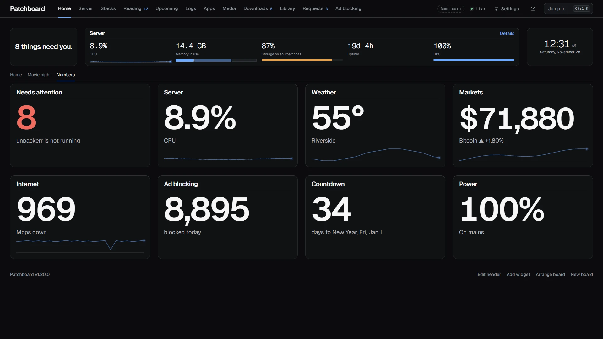

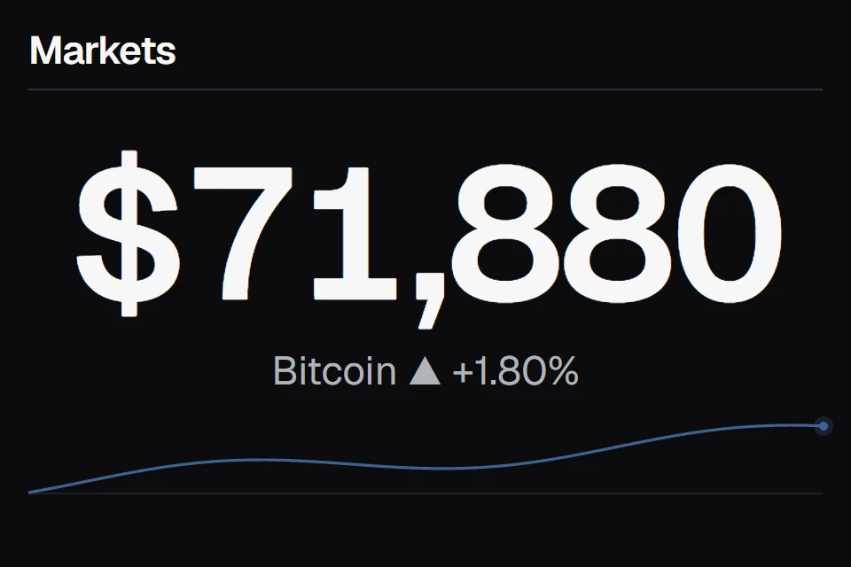

**A panel with no browser:** a TRMNL, a Pimoroni Inky, or an ESP32 with an
e-paper screen can show the server as a picture. Make a household device for
it in Settings, Devices, and New panel address gives you its picture address:
`/panel/<token>.png`, or `.bmp`. Add `?w=800&h=480` for the panel's size,
`?units=c` or `f`, `?clock=24`, and `?invert=1` for white on black. The
picture is one bit per pixel: the status and what needs you, the weather,
and CPU, memory and the pool, drawn in the Spleen bitmap font. For one
number instead, pick a widget under Panel shows, or add
`?widget=<board>/<widget>`: Bitcoin's price, CPU or the car's charge, as
large as the panel allows, with its line along the bottom.

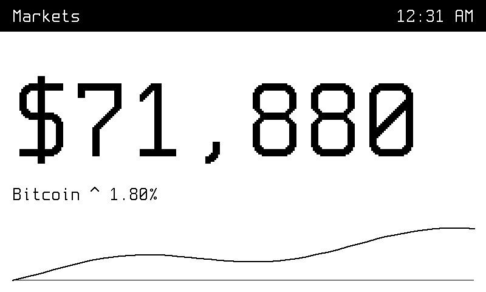

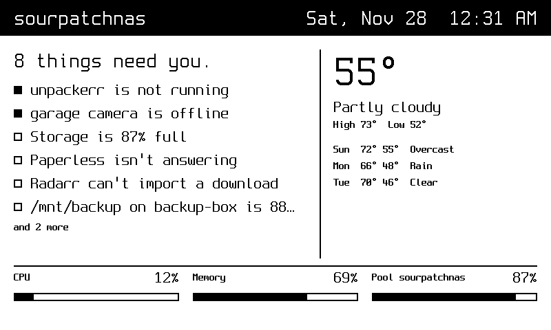

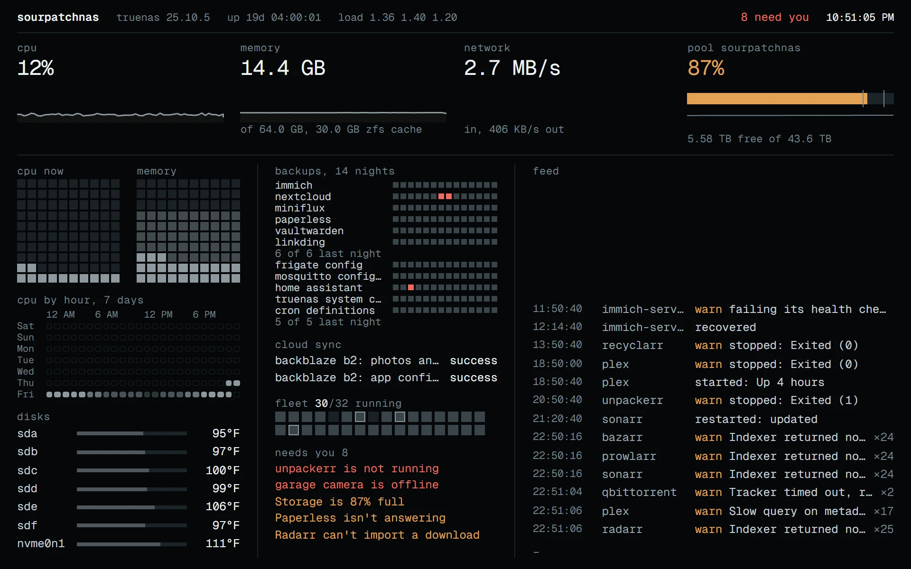

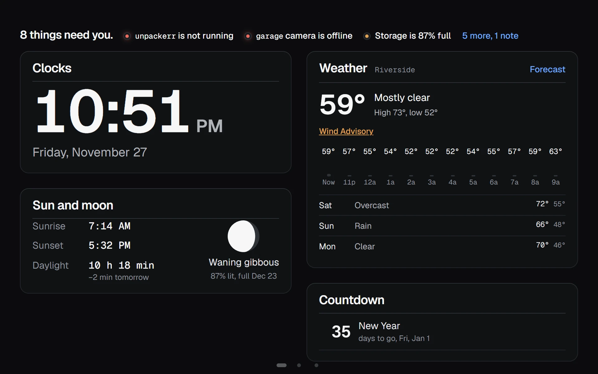

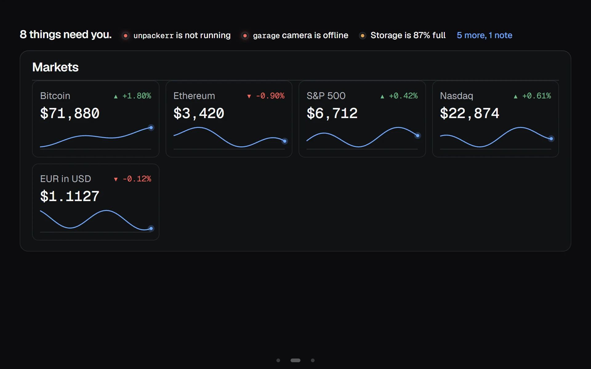

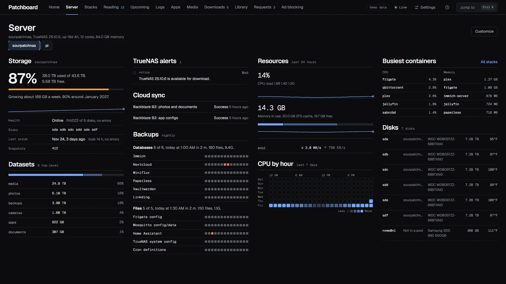

**A container:** what's wrong and the runbook's fix on the left, the live
logs beside them, and buttons to start, restart, update or roll back. With
an update waiting, What's new lists the releases since the version it runs,
read from the image's own source on GitHub, and marks a security fix or a
breaking change before you press Update. If the new image doesn't come back
healthy and answering within two minutes, Patchboard puts the old one back
on its own. Hold at this version keeps one you pin on purpose quiet until
you release it.

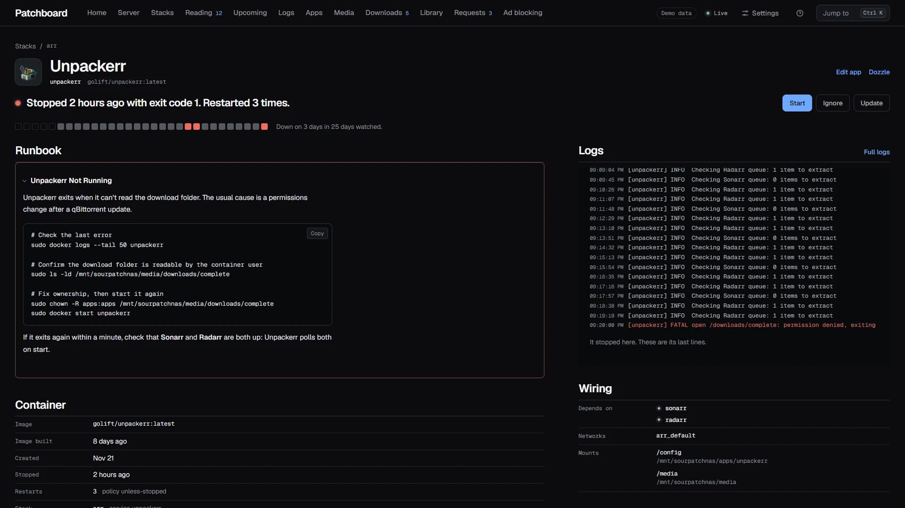

**Stacks:** every container by compose project. Sort by problems, CPU or
memory. Each stack folds to its header with Hide, and Hide all or Show all
folds or opens every one; on a phone the healthy ones start folded. Containers on your other machines, added under Other
Docker hosts in Settings, show as their own stacks ("dns on pi") and are
named like pihole@pi, with logs, history, start, stop and restart.
With image updates showing, hold Update on as many rows as you like:
one runs at a time, its row shows the step and a clock, and the rest say
which update they wait for and start on their own.

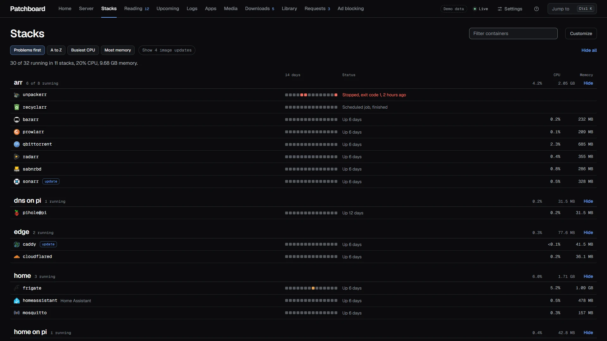

**Upcoming:** Sonarr, Radarr and Trakt in one calendar that starts today,
two weeks in two rows, with posters and no doubles. A phone gets a
day-by-day list.

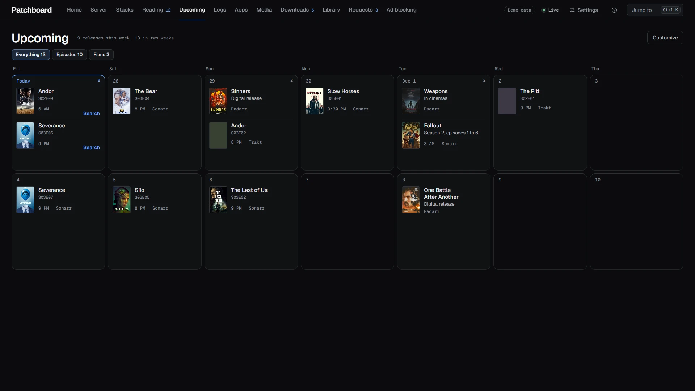

**Weather:** the next 24 hours, the week, sunrise and sunset, US alerts. The
weather widget's Display style makes it an office display: the
conditions now, large, the next 24 hours as one chart of temperature over
the chance of rain, and the week on one scale. "Wall: weather" starts a
board with it for a TV or a wall tablet. The Drawing style matches the
car's engineering drawing: a station plot of the wind, cloud and pressure,
the next 24 hours on the grid, and the week as dimension lines.

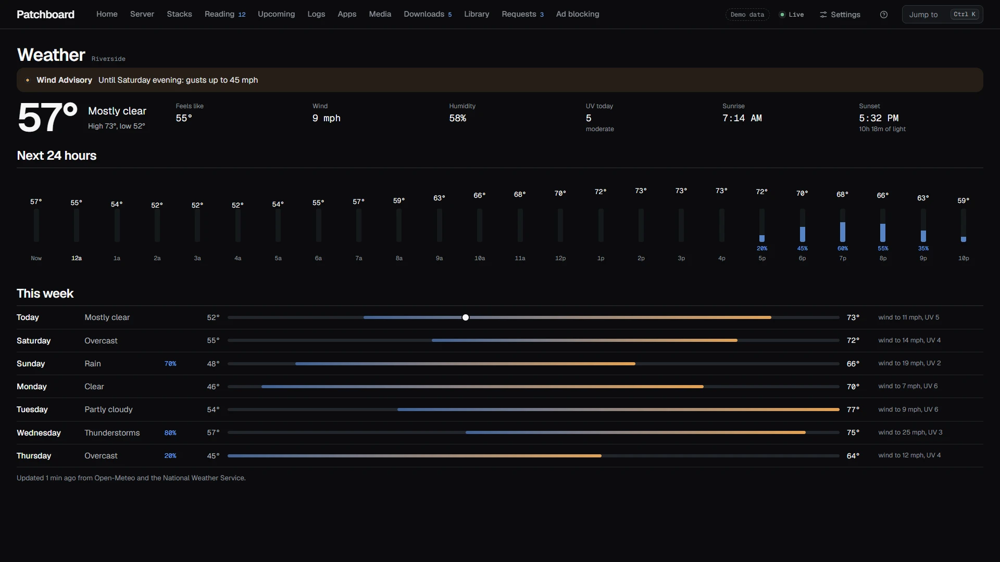

**Reading:** your Miniflux unread as a morning edition: a lead story, then the
newest from each category, with pictures and a link to the rest of each.
Search, filter by feed or time, sort, or mark a category read; on a phone
these fold under Filter and sort. Open an article and the list sits beside
it; `j` and `k` move, `o` opens the original.

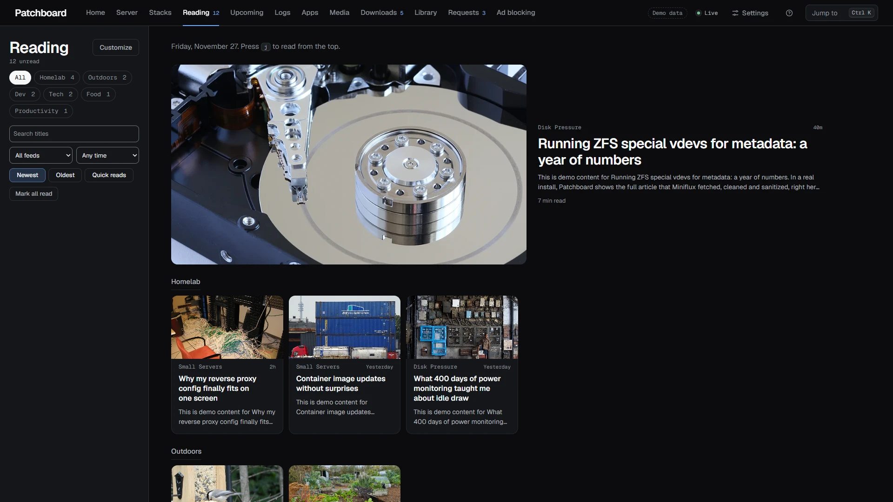

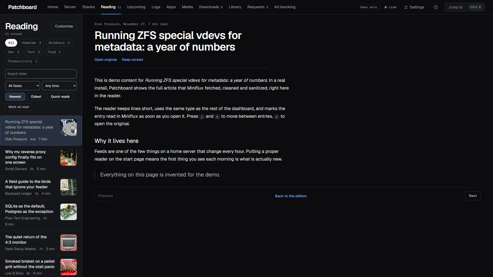

**The house:** Home Assistant lights, sensors and scenes, the car, Frigate's
cameras and Wake buttons, on the Home board. Tap a light or a scene; a lock
or a garage door only shows its state. Cameras shows each camera's newest
frame, refreshed every few seconds while it's on screen, and, for cameras
that detect, who and what came by today. Tap a camera to watch it live
right there; Escape, Close or switching tabs ends it.

**The car:** through Tessie, the charge and range with a line of the last
week, what it's doing (charging, full in an hour, at 11 kW), the inside and
outside temperatures, and the four tires on a blueprint of the car with a
soft one marked. Patchboard ships drawings of the cars it knows, with the
tires and charge port already placed, so there is nothing to upload. It
matches the model Tessie reports; to pick one yourself, set Drawing on the
Tessie connection in Settings (`TESSIE_CAR`). A car without a drawing yet
gets a plain outline. The drawings are line art on a clear background, so
they sit on any card in light or dark.

Its Dashboard style makes the card a live engineering drawing. The views
run across the top, the side view sits in the middle dimensioned in
millimeters, the live figures and the odometer sit beside it, and panels
for status, charging, range and tires run along the bottom. Swipe across the
car or press an arrow key to turn it through its views. Tap a metric, a
panel or a tire for its detail, a sheet of its own with the part drawn and
its history on ruled axes you can drag along. Tap a door, the frunk, the
trunk, the glass or the charge port, and hold to lock or unlock, open it,
start or stop charging, set the limit, or switch climate or Sentry. A
household device sees all of it and sends no command.

Shown alone on a screen (Settings, Devices), the sheet becomes a poster that
fills it, 4:3 on a squarer e-ink frame. On a TV the remote drives it: up
and down move between the metrics, the car and the panels, the center
button opens one and Back closes it. Left and right turn the car once it's
marked, and otherwise turn the TV's pages, as rewind and fast-forward do. Status says where it's
parked, by your name for the place or the town, and Range adds the last
drive, the week's distance and the energy per mile. Settings, Alerts sets
when a tire counts as soft. Patchboard records each reading Tessie has,
without waking the car, so the lines fill in from the day you set it up.
One number shows the battery, the range or the lowest tire.

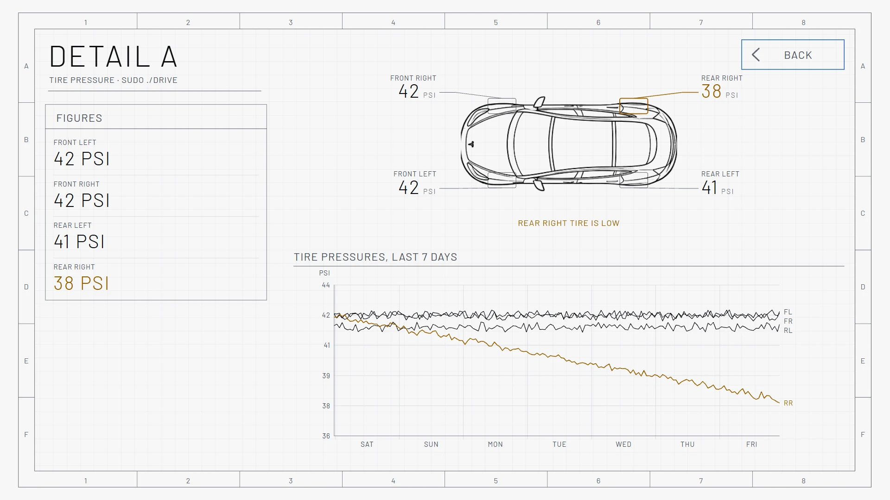

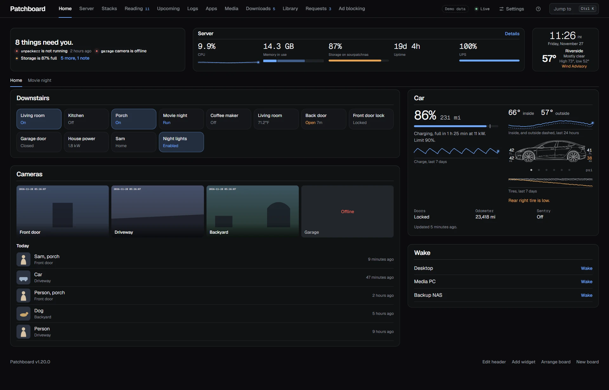

**The network:** Uptime lists Uptime Kuma monitors with problems first, each
with its last 30 checks; one that goes down joins Needs attention. Internet
shows the latest speed test and the last day as a line. Ad blocking shows
what Pi-hole or AdGuard Home blocked today and pauses it for 5, 30 or 60
minutes; it turns itself back on when the time runs out. Requests lists
what people asked for in Overseerr or Jellyseerr, with Approve and Decline.
Downloads lists every unfinished download with Pause, Resume and Remove, and
whatever Sonarr or Radarr is stuck on with Try another release. This week
offers Search for an episode that aired and never arrived.

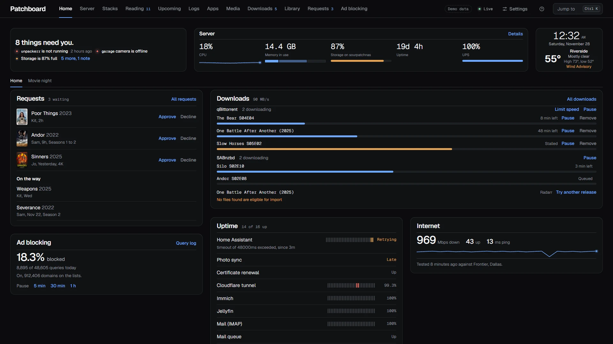

**The machines:** Hosts shows CPU, memory, the fullest disk, network and
temperature for every machine running Glances. Storage covers Unraid,
Synology and QNAP in one widget, volumes and every disk. Power shows each UPS
through NUT, Drives each disk's health through Scrutiny, Proxmox its nodes and
guests, Docker hosts every Portainer environment, Network your UniFi devices
and Tailscale machines. Each one raises its own trouble in Needs attention,
at the thresholds in Settings, Alerts.

**Home Assistant, for the family:** List keeps a Home Assistant to-do list,
Shopping list or Chores, with a box to add to it and a tap to tick an item
off. Thermostat shows the temperature inside and sets it with minus and plus.
Shades opens, stops and closes blinds, while garage doors and gates only show
their state. People shows who's home. Rooms gives each temperature sensor a
strip of its last day. Chores needs no Home Assistant: name the jobs and
how often (Water the plants=7), and it counts the days since each and
starts over at Done. A household tablet on the fridge can do all of it.

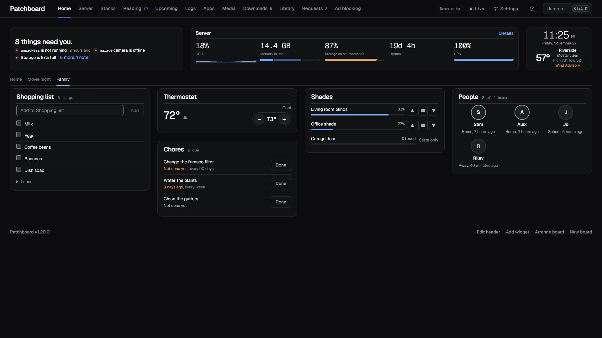

**Miners:** BitAxe and other AxeOS miners (NerdQAxe, Gamma, Supra), a block
each: hashrate with a line of its day, the ASIC's temperature, power and
joules per terahash, the best difficulty and shares. One that runs hot or
stops answering shows in Needs attention. Give it one address or several.

**The other apps:** Media managers gives Lidarr, Readarr, Prowlarr and
Bazarr a line each, healthy or what's wrong, with the queue or the missing
subtitles. Documents shows the Paperless inbox, Nextcloud its files, people
on today, free space and app updates, Git the notifications waiting in Gitea
or Forgejo, and Monitoring alerts what's firing in Netdata or Prometheus.

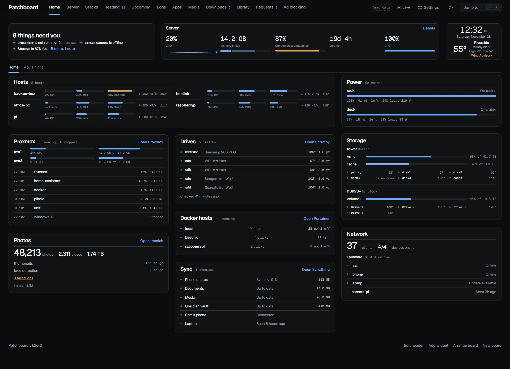

**The household:** a Calendar from any iCal address, Notes with checklists
the house shares, what you are reading on Hardcover or Goodreads, what
everyone watched lately on Plex, Jellyfin and Emby, and the audiobooks in
progress and albums played lately on Audiobookshelf and Navidrome.

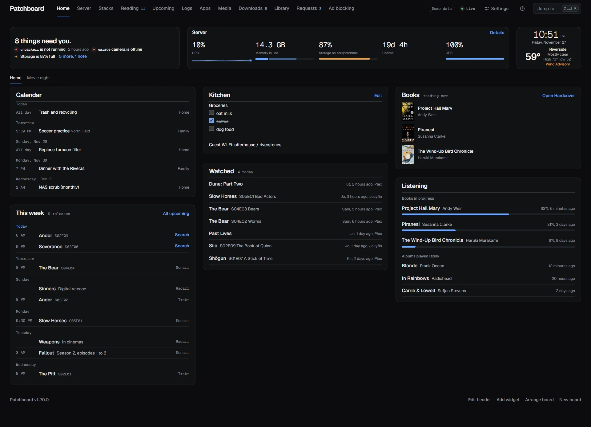

**No setup needed:** Links puts your links on the board, Search sends
words to the engine you pick or, with `!yt`, `!sonarr` and the like, straight
to a site or one of your apps, Clocks shows the time where your people are
(or one big clock and the date), RSS feeds reads any RSS or Atom feed without a
reader app, and Releases follows the newest version of the GitHub projects
you name. Markets follows coins, stocks, funds, indexes and currencies with
the day's line, no key needed: write `BTC`, `AAPL`, `^GSPC` or `EUR/USD`.
Sun and moon shows sunrise, sunset, the day getting longer or shorter, and
tonight's moon. Countdown counts the days to the dates you name.

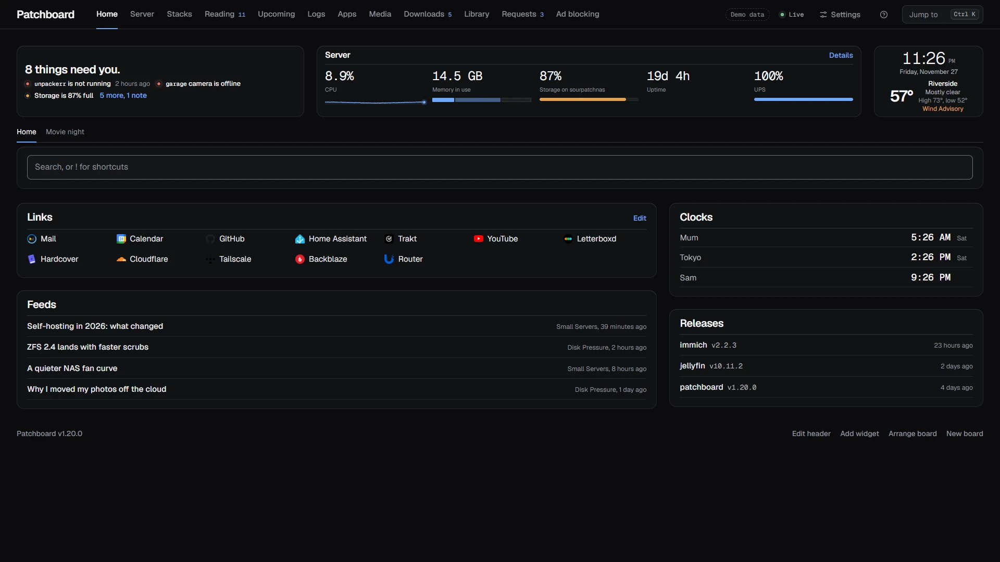

**Downloads:** everything in qBittorrent, Transmission, Deluge, SABnzbd and
NZBGet on one list, running or failed first: progress, speeds down and
up, time left, size, what each torrent took and gave back, its ratio,
category and tracker. Filter by what it's doing or by name.
Pause and resume are a tap; remove is a hold, and a torrent can go with
its files or without them. Paste a magnet link or a web address, or add a
.torrent or .nzb file; Patchboard sends it to the client that takes it.
The list comes straight from the clients every few seconds while the page
is open. Details opens a torrent: skip a sample, put the next episode
first, cap its speed, or move it to another qBittorrent category.

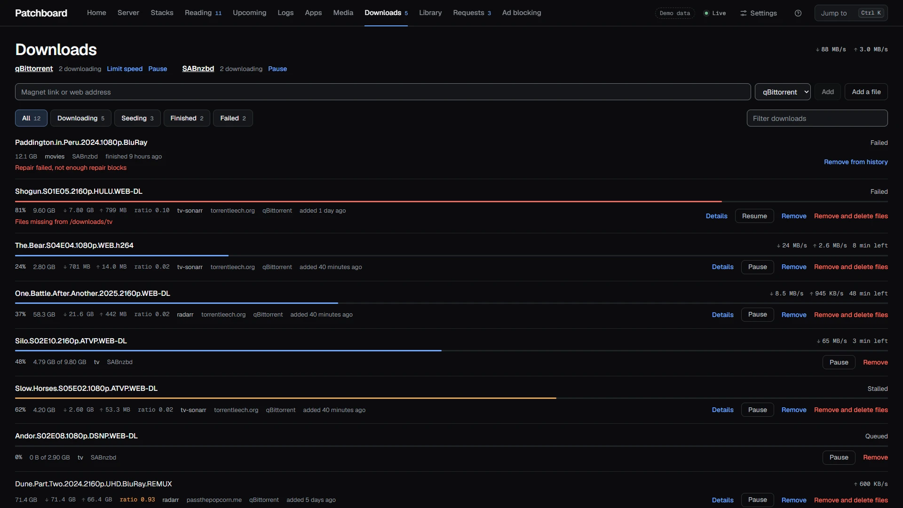

**Library:** Sonarr's shows and Radarr's films, each with its poster, how
many episodes are on disk, its size and whether it's monitored. Filter by
name, switch monitoring, or search for what's missing. Missing lists every
monitored episode or film without a file, to search one at a time or all
at once. Queue has the whole queue, with Try another release and Remove.
Add finds a show or film by name and adds it with the quality and folder
you pick. Seasons and episodes opens a show to monitor or search one
season, or one episode. History shows what Sonarr or Radarr grabbed,
imported or gave up on, and why.

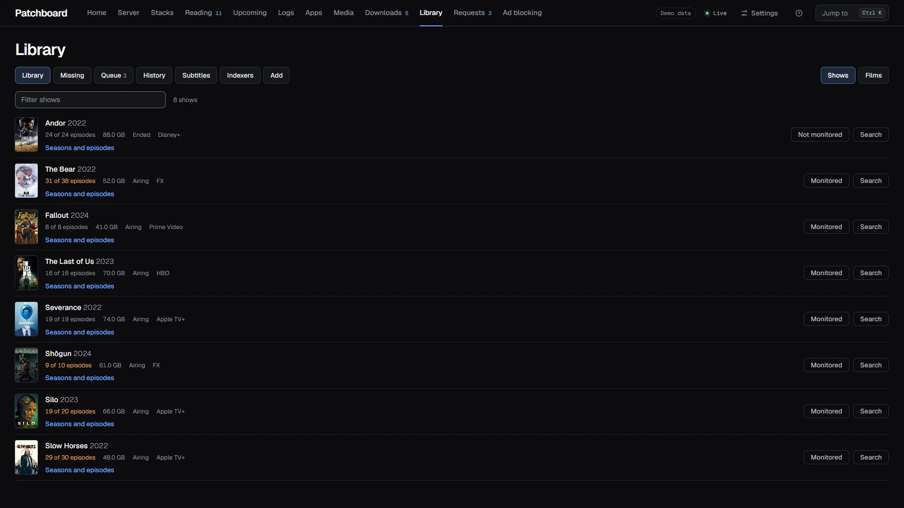

With Bazarr, Subtitles lists what still lacks subtitles and in which
languages, with Search. With Prowlarr, Indexers shows how each indexer has
done and which ones are failing, with Test and Turn off.

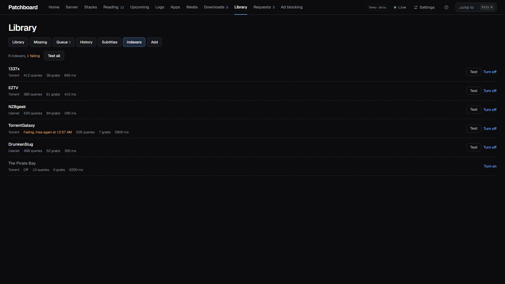

**Requests:** Overseerr's or Jellyseerr's requests. Waiting has every one
that needs approval, with who asked and when, to approve or decline.
On the way lists what's approved and not here yet. New request finds a
film or show by name, shows whether it's already here, asked for or on
the way, and requests it.

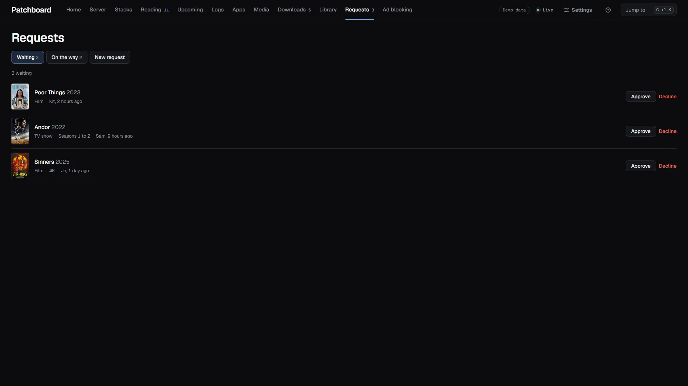

**Media:** Plex, Jellyfin and Emby together. Watching has every stream:
who, on what device, direct play or transcoding, and the time left. Hold
Stop to end one, and the viewer sees a note that you did. Libraries lists
each library with how much it holds and when it was last scanned, with
Scan beside it. Open one for its episodes or tracks, the folders it reads
and what came in last, one poster per show. Plex works on its own with its address and token, or
through Tautulli. A stream's title opens the same card as on Home, with
Stop, and on a phone, Open in the Plex app.

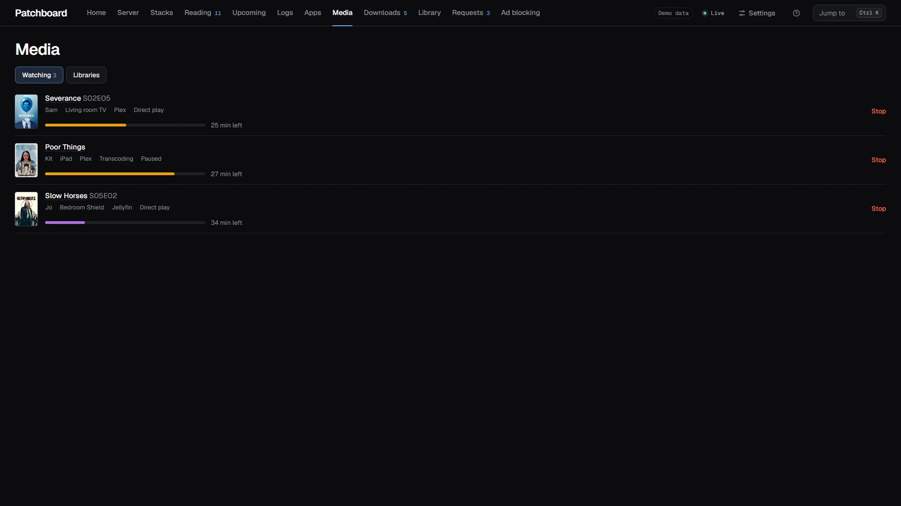

**Ad blocking:** Pi-hole or AdGuard Home. Queries shows each device's
lookups as they happen and what blocked them. Filter by domain or show
only blocks, then Allow a domain a list caught by mistake, or Block one
that slipped through. Your lists keeps the domains you allowed and
blocked, and takes a new one by name.

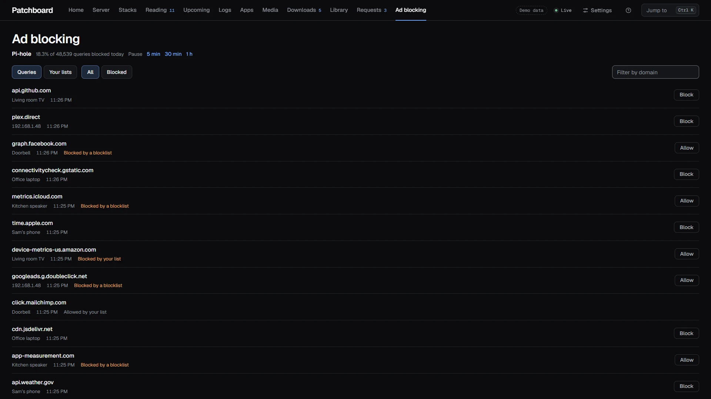

**Logs:** live from Docker, each line stamped in your own time, whatever
zone the container runs in.

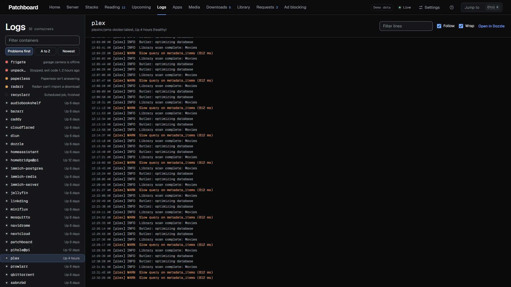

**Jump to:** `Ctrl K` or `/` reaches any app, page, container, article or
message, and every board, wall boards too. Before you type, it lists what needs attention and what you opened
last. Each app is one row: Enter opens it, the right arrow reaches its
details and logs, and typing "sonarr logs" lands on the logs.

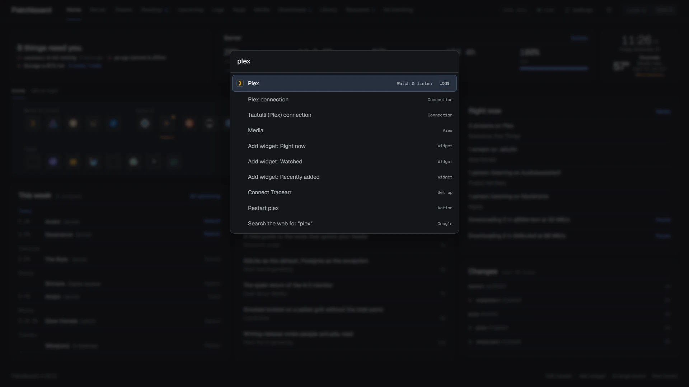

Press `?` for keyboard shortcuts. Help also has Suggest an idea, Ask for an
app and Report a problem, which open the matching GitHub form with your
version filled in; on a phone they're in More. Each app group on Home is one Tab stop;
arrow keys move between its apps. Help and the editors contain focus, close
with Escape, and return focus to where you opened them. Closing an editor
without saving leaves its settings intact.

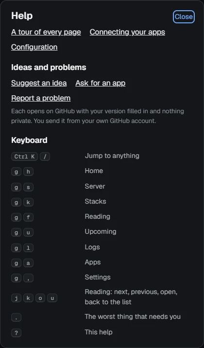

## Making it yours

**Arrange the board.** Drag widgets, drag an edge to resize, choose the
columns, or start over from a layout. Drag into a column, above or below
its neighbors; the layout updates while you drag. Hover or focus a card for
its controls, or choose a Column in its settings. Editing keeps the full
card preview and the same fitted counts; the arrange bar floats at the
bottom instead of pushing the board down. Its row holds the everyday moves,
Add widget, Cancel and Save; columns, Fit, colors, layouts and Reset sit
under More. Colors gives a board its own theme, mode and accent, on every
screen that shows it, so the kitchen board can stay light while the rest
stay dark. E-ink screens keep their ink. Fit the window trims lists until the board ends at the bottom of the
screen. Recently added keeps every selected poster in one horizontal row,
rather than losing titles to fit. Right now folds to one line per service
before the other lists lose much. If lists alone can't fit the board, they
keep their full length, the page scrolls, and Arrange board reports how far
it runs over. Fit recalculates when the window width or header height
changes. New board, at the foot of any board, adds another with its own
name, starting empty or from a layout; tabs over the board switch between
them. Six layouts are made for a screen on the wall: clock and weather,
markets, house, cameras, media, and the car, large with its tires beside
its battery, range, charging and locks. A board set For a wall screen shows one
status line instead of the header, and no tabs, and it stays off Home's
tabs; Settings, Devices lists each one to edit.

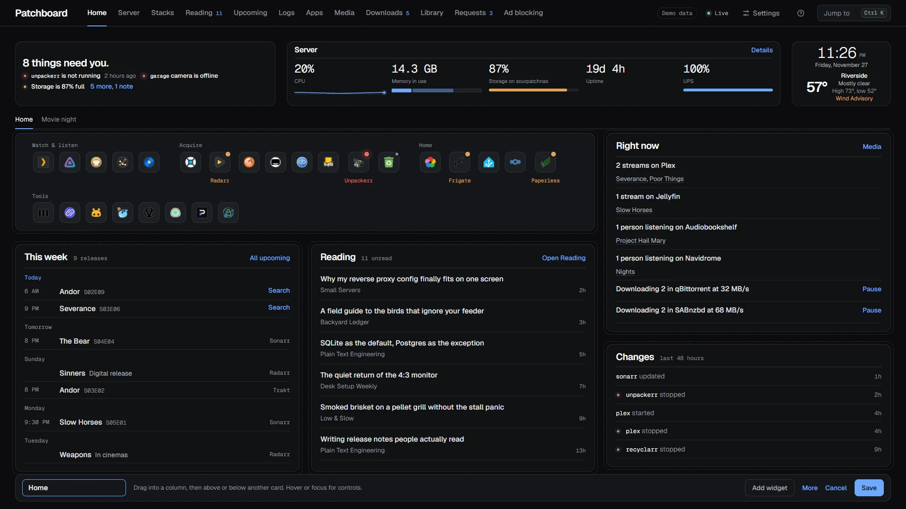

**Add widget.** At the foot of any board, or in its arrange bar. Every
widget shows as it would on your board, live, grouped into Everyday, Media,
Server, Files and work, and House and network. A widget whose app isn't
connected yet shows made-up data marked Sample, with what it needs under
it. Pick one and it opens large: choose its width and watch the preview
change, set its options beside it, then Add to Home. If it needs an app,
Connect is right there, and Add turns on once it's connected.

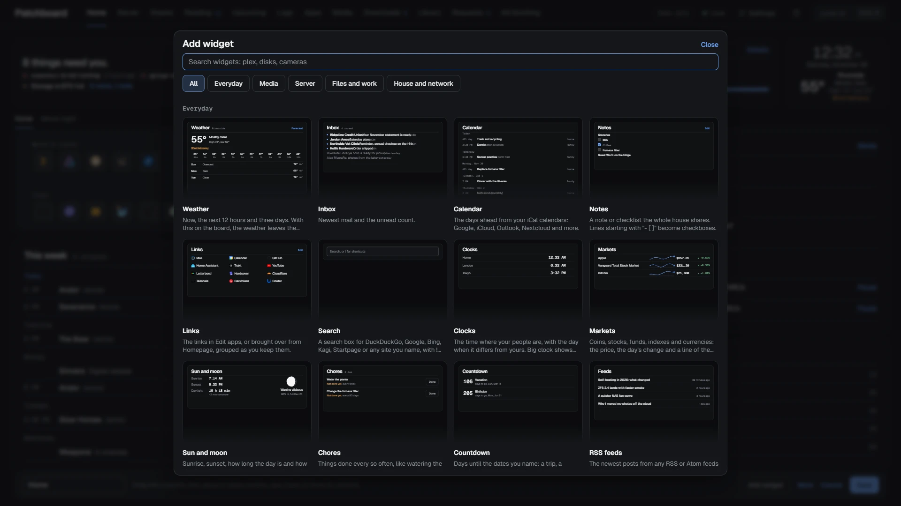

**Widget settings** open the same way, the widget large beside its name,
width, column and items, so each change shows before you keep it. Cancel
puts it back as it was.

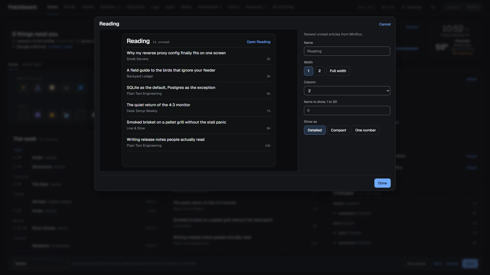

**Edit apps.** Drag apps between groups, rename groups, hide anything, add
apps. Each board's Apps widget can show only the groups you tick in its
settings: Home with what you use every day, a Work board with only that.
Cameras picks its cameras the same way.

Icons come from two open sets, dashboard icons and selfh.st, matched by the
app's image, container and service names. Tap an app's icon in Edit apps to
upload your own. An app Patchboard has an integration for, such as Sonarr or
Plex, shows Connect on its tile until you set it up.

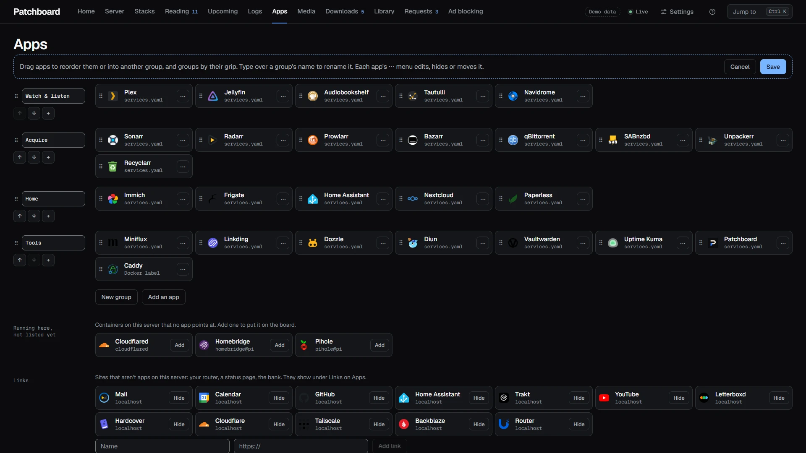

**A live number on any app.** Pick the app and press Test. One you've
connected uses that connection; any other asks for its key once.

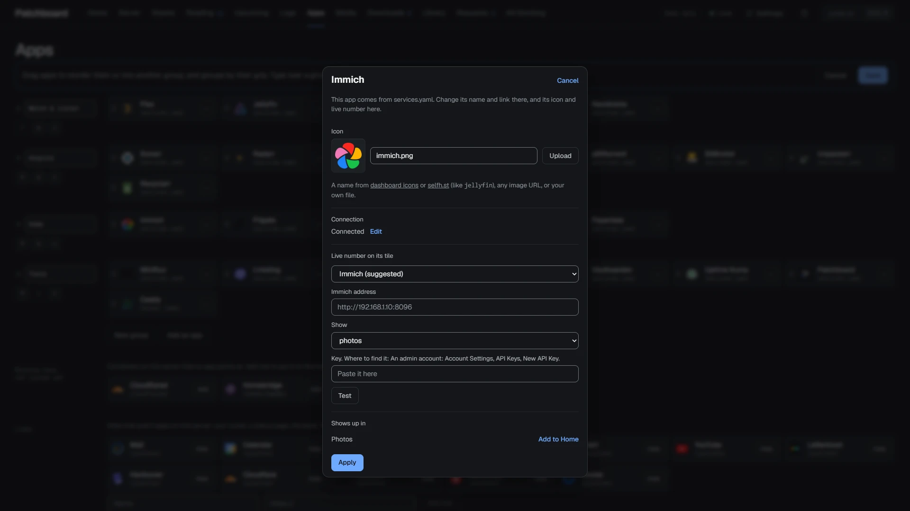

**Customize any page.** Here, the Server page's sections.

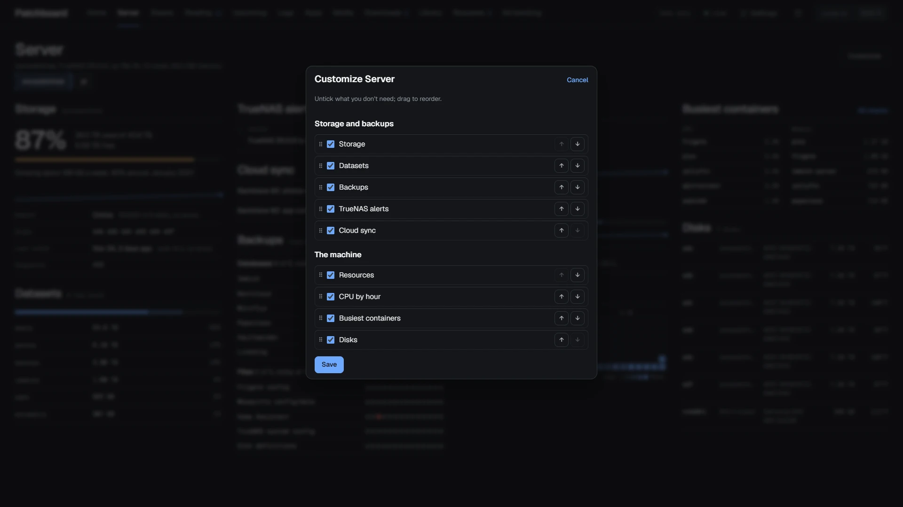

**Settings** has themes, colors, type and density, saved per browser; the
Home header is under Home. A new browser or home-screen app starts from the
last look you saved. Language and region, under Look, switches Patchboard to
German, Spanish, French, Italian, Dutch or Portuguese, and writes dates,
times, numbers, prices and temperatures the way your part of the world does:
"jeudi 12 novembre, 14:30, 1 234,50 €" in France.

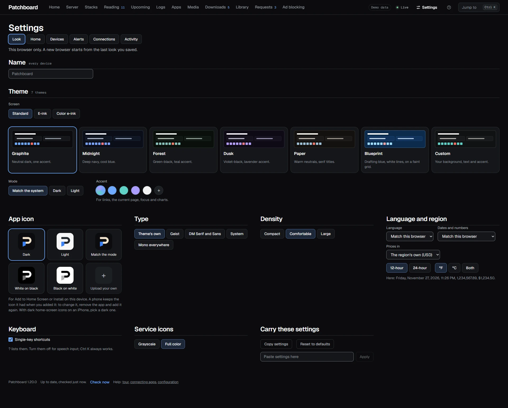

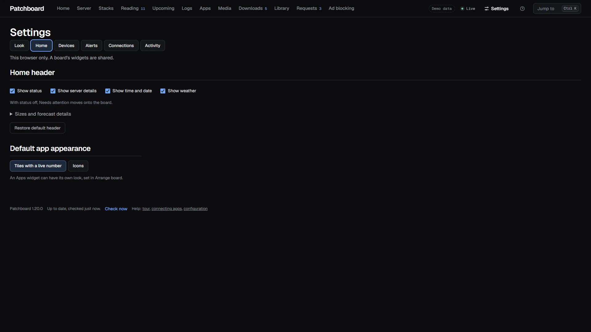

**Devices** lists every wall tablet, e-ink panel and family phone with a
household link. Pick one to set the page it opens on and the pages it swipes
through, in order. Beside each board, Edit board opens it for arranging and
Save brings you back to the device; Colors sets that board's theme, mode and
accent. Below: its screen, night dimming and Monitor colors, and its theme,
density, units and language. A new link or a new panel address retires the
old one.

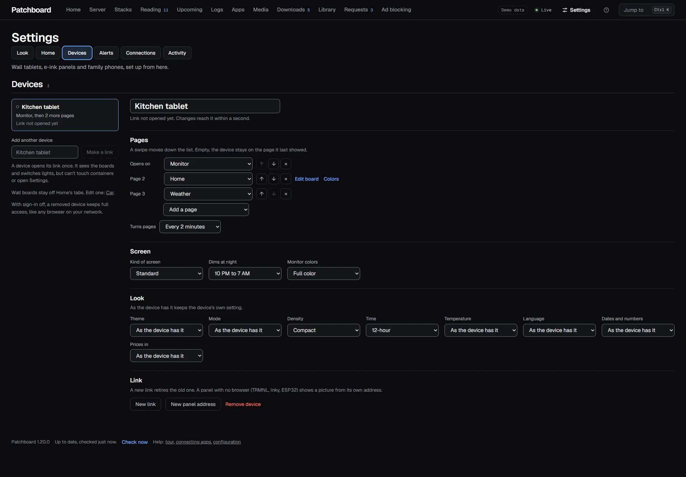

**Connections** holds sign-in, your app catalog, backups, and the ways
alerts reach you. Apps themselves connect from their own sheet in Apps:
the address and key, a test, and Save. The server encrypts keys and never
shows them again; anything set in the environment file shows as locked.

**Settings, Alerts** sets when storage counts as full and a drive as hot,
with a warning and an alarm level for each, for every device at once.

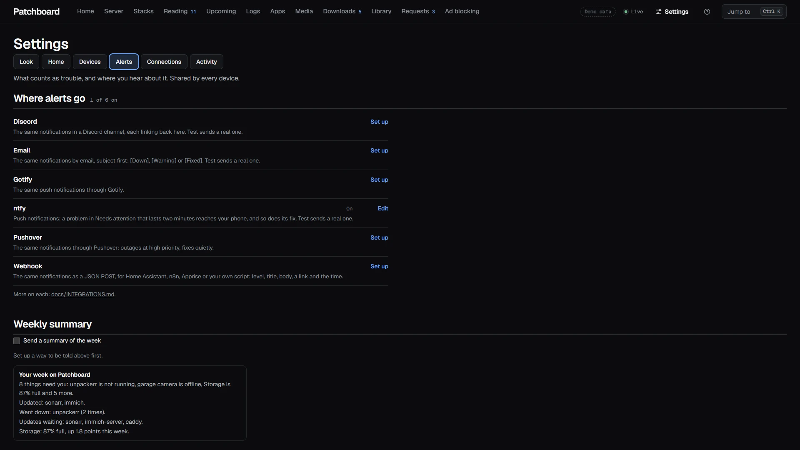

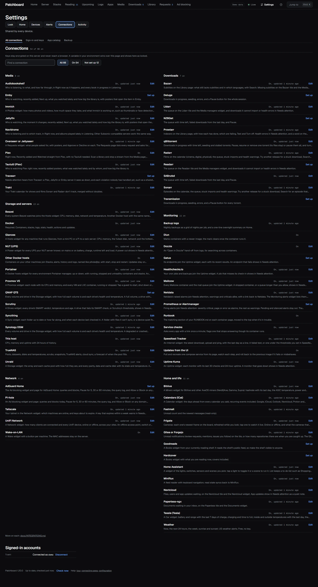

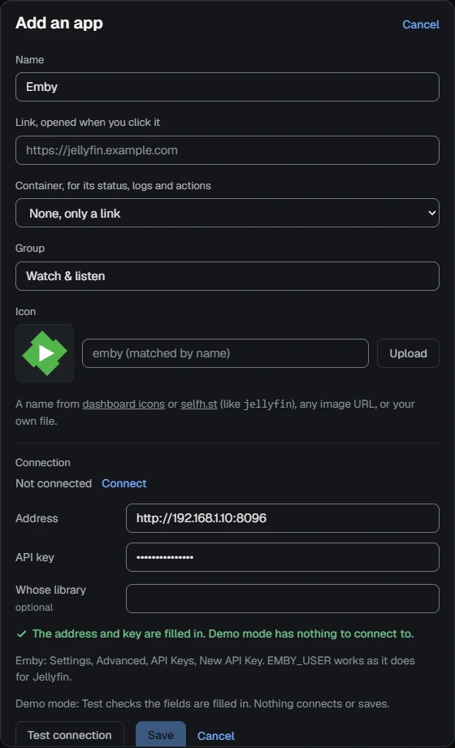

## Themes

| | |
|---|---|
| 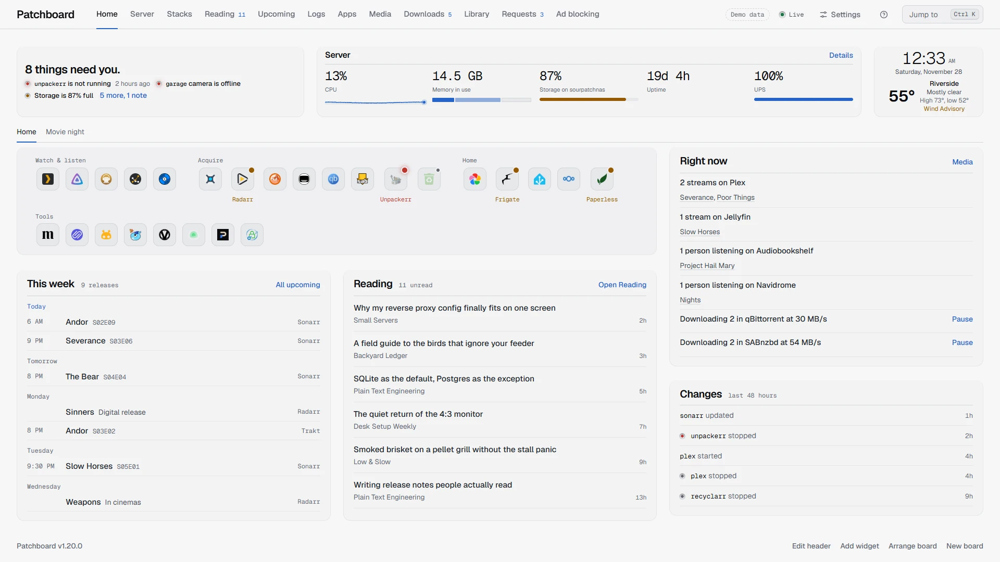 Graphite, light | 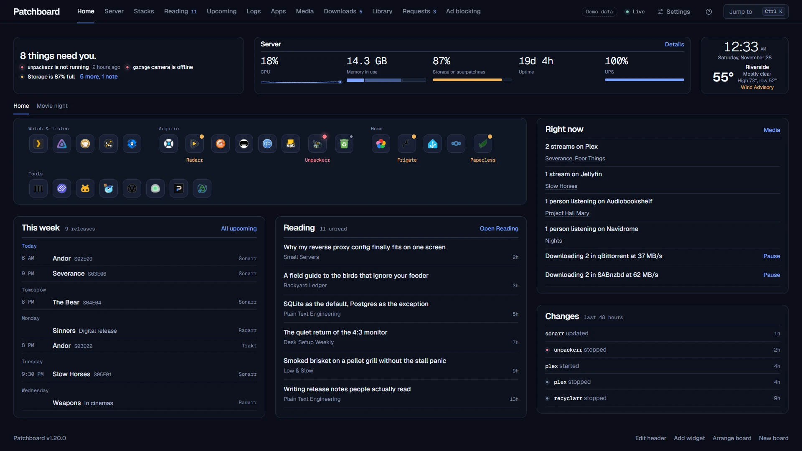 Midnight |
| 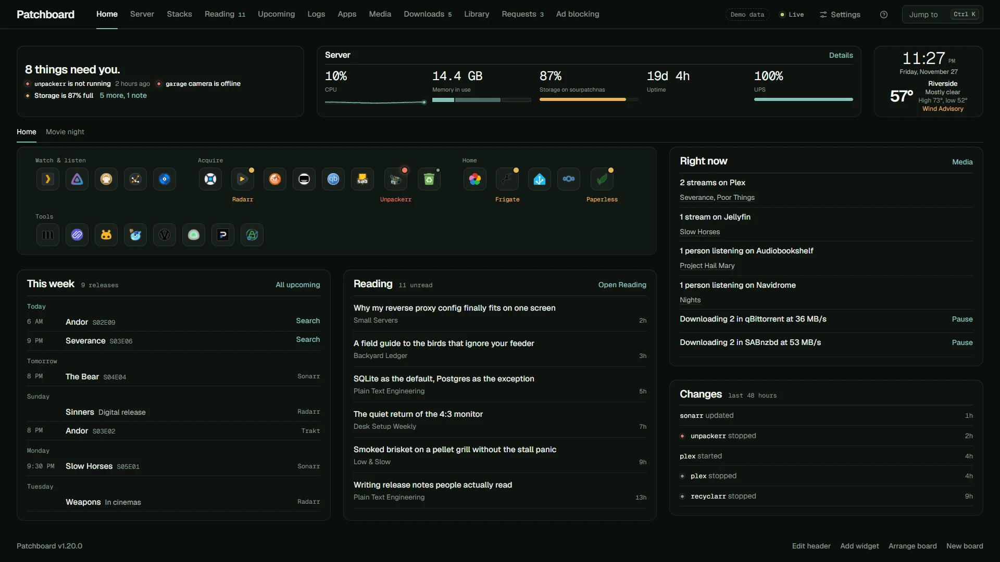 Forest | 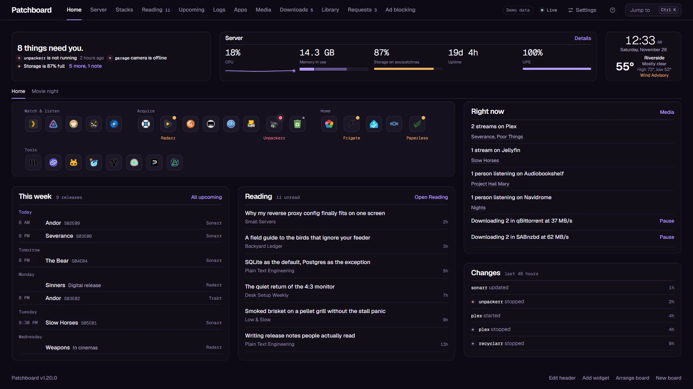 Dusk |
| 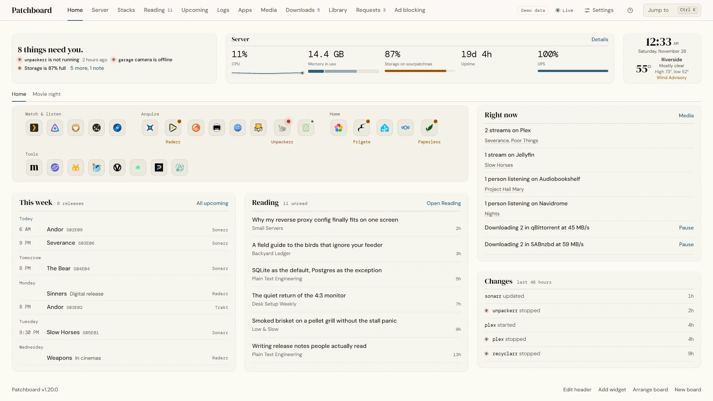 Paper |  Blueprint |

Every theme comes in dark and light. Blueprint is drafting blue with white
lines on a faint grid, or a pale whiteprint in light. A Custom theme starts
from three colors.

## On a phone

The tab bar holds Home, Server, Stacks and Reading (Upcoming until Miniflux
is set up). More opens every other page and Settings. Every button and link
is big enough for a fingertip. Installed on the home screen, pull the page down to
reload it. Tap an alert without a link to read why. Pages don't zoom on a
phone, pinch or double tap; Density in Settings, Look makes everything
bigger.

**One widget as its own app.** Open a single widget (Settings, Devices
lists every one, or /w/home/<widget>) and Add to Home Screen: it installs
under the widget's name and opens straight to it, so the car or the
weather is one tap from the phone's home screen. Sign-in still guards it.

| | | | | |
|---|---|---|---|---|
|  |  |  |  |  |

## First run

One sheet, filled in already: a name and an icon, the town for the weather,
this browser's language, clock, units and region, and the running containers
that look like apps, grouped by compose stack. Open Patchboard takes it as it
is; Restore a setup file brings over another server's boards and apps. Each
field lives in Settings afterward.

If you're coming from Homepage, paste its `services.yaml` in Settings,
Connections, and your apps, groups, icons and links come over. Its widget
keys stay behind; Patchboard names the integrations worth connecting instead.

### Server details in the header

Server details are in the header by default, including CPU history, memory,
storage, uptime and the Details link. With NUT connected, the UPS joins
them: its charge, and "On battery, 23 min left" when the power is out. Use
Edit header on Home to turn parts off for this device. If your saved board still has a Server card,
Arrange board can remove that copy.

